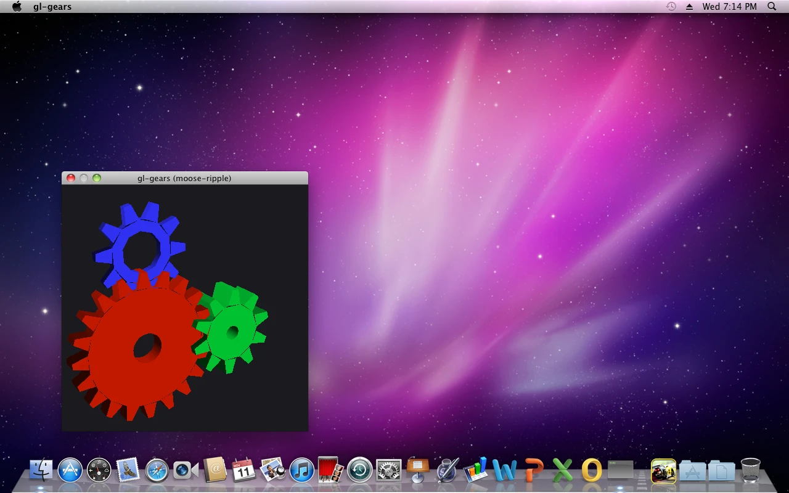

# moose-ripple

**Hardware acceleration for Mac OS X 10.6 Snow Leopard virtual machines, using the host GPU.**

Snow Leopard, like Mac OS X in general, has no driver for a virtual GPU, so in a virtual machine
it can only draw with the software renderer. For years I wanted a portable way to see that
Dashboard ripple again in a VM, and now it's finally doable.

This project is a guest driver for QEMU's standard **virtio-gpu** card with **virgl**, the
paravirtual 3D path that hands OpenGL to the host. Snow Leopard sees a graphics card, OpenGL
renders on the host GPU, and WindowServer composites the desktop on it. No period hardware, no
GPU passthrough.


*Snow Leopard's Dashboard on moose-ripple, seen through Proxmox's VNC console.*

moose-ripple is still at an early stage, and it won't replace GPU passthrough. I'm working on
the performance, but translating every call to the host will always leave a gap to a real card
inside the VM.



*gl-gears drawing on the host GPU, under the translucent menu bar.*

| moose-ripple | Software rendering |
|---|---|
|  |  |

*The ripple effect!*

## How it works

```
 Guest: Mac OS X 10.6.8
 ┌───────────────────────────────────────────────────────────────┐
 │ Apps, WindowServer, Core Image, Core Animation                │
 │      │ OpenGL / CGL                       │ 2D blits          │
 │ RippleGLDriver.bundle                RippleGA.plugin          │
 │  Mesa virgl driver + a CGL front end  (WindowServer's         │
 │      │ IOKit user client               graphics accelerator)  │
 ├──────┼────────────────────────────────────────────────────────┤
 │ RippleVirtioGPU.kext                                          │
 │  virtio transport, framebuffer and cursor, accelerator        │
 │  surfaces, virgl contexts, resources and fences               │
 └──────┬────────────────────────────────────────────────────────┘
        │ virtio-gpu (virgl)
 Host:  QEMU (virtio-vga-gl) ─► virglrenderer ─► host OpenGL ─► any GPU
```

- `RippleVirtioGPU.kext` drives the virtio-gpu card: display modes, scanout, the hardware
  cursor, and the 3D commands the GL driver sends. To Snow Leopard it looks like a graphics
  card with an accelerator.
- `RippleGLDriver.bundle` is an OpenGL renderer plugin, loaded by Apple's OpenGL framework like
  any vendor driver. Inside is Mesa's virgl Gallium driver, built for 10.6.
- `RippleGA.plugin` gives WindowServer the 2D blitter it asks for before it will composite the
  screen with OpenGL.
- `RippleQEMUTablet.kext` (optional) makes QEMU's USB tablet work as an exact absolute pointer.

The boundary between the GL bundle and the kernel is small, versioned and GPU-neutral:
[docs/kext-uapi.md](docs/kext-uapi.md). The design and the plan are in
[HANDOFF.md](HANDOFF.md), the decisions in [docs/decisions/](docs/decisions/).

## What works

- Quartz Extreme: WindowServer composites the whole screen on the GPU. The menu bar and menus
  are translucent over a blurred backdrop, Exposé and Dashboard animate on the GPU, and adding a
  widget sets off the ripple.
- OpenGL 2.1 for apps, 32- and 64-bit, through Mesa's virgl driver. Apps see the renderer as
  `virgl (Mesa Intel(R) UHD Graphics 630 (CFL GT2))` on the test host. Quartz Composer, Front Row,
  the Flurry screen saver and games such as Angry Birds Rio run on it.
- Core Image on the GPU: its filters and Photo Booth's effects.
- Sound, with no driver of ours: QEMU's USB audio device and Snow Leopard's own driver (tested
  in UTM; [docs/install.md](docs/install.md#sound-optional)).


*Top: software rendering, an opaque white menu bar. Bottom: moose-ripple, the
translucent menu bar with the desktop showing through. Both from the same VM.*

### Tested hosts

| Host | How QEMU runs | Host GPU | What was checked |
|---|---|---|---|
| Linux: Proxmox VE 8.4 | with KVM | Intel UHD Graphics 630 | everything in this README, and the numbers below |
| Windows 11 | with KVM, inside WSL2 | NVIDIA GeForce RTX 4090, through Direct3D 12 | Quartz Extreme, the translucent menu bar, the Dashboard ripple, gl-gears at about 55 frames/s |
| macOS 26 on Apple silicon | in UTM 5.0.8, x86 emulation | Apple M1 Max, through Metal | Quartz Extreme, the translucent menu bar, gl-gears at about 55 frames/s; the pointer is invisible (KI-8) |

How to set up each: [docs/install.md](docs/install.md#2-set-up-the-vm).

### Measured

**It can still stutter at times because of the translation layers, despite what the numbers say.**

The test machine is a Proxmox VE 8.4 host with an Intel Core i9-9900K and its built-in Intel UHD
Graphics 630. The guest runs at 1280x800 with 4 virtual CPUs. The software rendering column is
the same VM booted without moose-ripple. The GeForce 9600 GT column is the same Snow Leopard
install with a real GeForce 9600 GT passed through to it, running Apple's own NVIDIA driver at
1920x1080 (its monitor has no 1280x800 mode), so each of its screens has about twice as many
pixels.

| | Software rendering | moose-ripple | GeForce 9600 GT |
|---|---|---|---|
| Quartz Composer (Arabesque) | doesn't start | 60 frames/s | 58 frames/s |
| Angry Birds Rio | doesn't start (needs OpenGL 2.0) | 59 frames/s | 60 frames/s |
| Flurry screen saver | 29 frames/s, 66% of a CPU | 27 frames/s, 4% of a CPU | 30 frames/s, 2% of a CPU |
| Dashboard animation, screens per second | 7.4-7.9 | 13.6-14.2 | 10.8-11.9 (1920x1080) |
| Exposé animation, screens per second | 3.6-5.3 | 7.8-11.2 | 7.4-10.5 (1920x1080) |

- Screens per second is the mean of WindowServer's own frame meter (the one in Quartz Debug),
  counted in full screens' worth of pixels.
- Core Image: 23 of 24 filters give the same picture as software rendering, and 55 of Photo
  Booth's 61 effects do ("the same" means within 1-2 colour levels, or under 1% of the pixels
  different). A single Core Image filter is slower than software rendering for now, because each
  render makes a round trip through QEMU. The 9600 GT differs from software rendering in nearly
  the same effects as moose-ripple does, so most of those differences come from how a GPU
  computes them.
- The host GPU's minimum clock was raised to 1200 MHz for these numbers
  (`/sys/class/drm/card0/gt_min_freq_mhz` on Intel). At the default 350 MHz each screen update
  takes about 5 ms longer.

Details: [docs/re/perf-notes.md](docs/re/perf-notes.md) and [docs/re/m6-notes.md](docs/re/m6-notes.md).

### Not working yet

- Real Racing 2: the intro movie draws nothing and the game's own picture is sheared into five
  side-by-side copies ([#8](https://github.com/mizaimao/moose-ripple/issues/8)).
- Chess: the 3D board stays black ([#9](https://github.com/mizaimao/moose-ripple/issues/9)).
- Core Image Fun House shows no image (with software rendering too).
- iMovie hasn't been tried yet. Photo Booth's live effects need a camera, which the test VM
  doesn't have, so the effects were tested on a still photo ([#11](https://github.com/mizaimao/moose-ripple/issues/11)).
- The OpenGL windows of apps are copied back through the guest every frame: about 20-30 ms per
  frame for a 1280x800 window. The next performance pass keeps them on the GPU ([#10](https://github.com/mizaimao/moose-ripple/issues/10)).
- Through QEMU's VNC display, a key press takes about 0.2 s to show on screen, and every extra
  VNC viewer (another Proxmox console tab, for example) makes the picture less smooth for all
  of them ([#10](https://github.com/mizaimao/moose-ripple/issues/10)).
- `open -a "Front Row"` starts Front Row without showing it. Start it with Cmd+Esc.
- Only Mac OS X 10.6.8 with the 64-bit kernel. AMD host GPUs haven't been tried yet.
- In UTM the pointer is invisible, though it still moves and clicks. UTM doesn't draw it;
  reported to UTM as UTM issue 8139 (KI-8 in [docs/known-issues.md](docs/known-issues.md),
  [#18](https://github.com/mizaimao/moose-ripple/issues/18)).

Some problems of 10.6 in QEMU show up without moose-ripple too: a panic when the guest goes to
sleep (KI-6), live snapshots that panic it (KI-5) and the pointer drifting with QEMU's USB tablet
(KI-1). They are in [docs/known-issues.md](docs/known-issues.md), with workarounds.

## Getting started

There are no ready-built downloads, and Mac OS X must come from your own copy.

1. Build the guest files on Linux: [docs/building.md](docs/building.md).
2. Set up the VM for your host: [Proxmox VE](docs/install.md#proxmox-ve),
   [plain QEMU](docs/install.md#plain-qemu), [Windows 11 through WSL2](docs/install.md#windows-11-wsl2)
   or [UTM on an Apple-silicon Mac](docs/install.md#utm-on-an-apple-silicon-mac).
3. In Snow Leopard 10.6.8, open the files from a CD image, run `sudo sh install.sh` and restart.
4. Check: the menu bar is translucent, and a widget dragged out of the Dashboard's widget bar
   makes the water ripple.

All the steps, the boot flags and how to remove it again: [docs/install.md](docs/install.md).

This repository contains no Apple software, firmware or keys. Mac OS X 10.6 (and, to build from
source, Xcode 3.2.6 and its SDK) must come from your own legal copies, and running Mac OS X in a
virtual machine is subject to Apple's license terms.

## Ideas for later

None of them is scheduled: [docs/future-ideas.md](docs/future-ideas.md). The main ones are a
second performance pass, native context instead of virgl, and Mac OS X 10.5, 10.7 and 10.8.

## Credits

moose-ripple builds on:

- [Mesa](https://mesa3d.org) and its virgl Gallium driver (MIT), the GL implementation inside
  RippleGLDriver.bundle.
- [virglrenderer](https://gitlab.freedesktop.org/virgl/virglrenderer) (MIT), which runs the
  guest's GL on the host. Its protocol headers are in [third_party/virgl](third_party/virgl).
- [QEMU](https://www.qemu.org) and its virtio-gpu device. The virtio headers from Linux are in
  [third_party/virtio](third_party/virtio), with their own licenses.
- [OpenCore](https://github.com/acidanthera/OpenCorePkg) (BSD-3-Clause), the boot loader.
- [cctools-port](https://github.com/tpoechtrager/cctools-port), the Mach-O linker that lets a
  Linux box build 10.6 kexts.

Prior art, studied but no code used: VMsvga2 (VMware SVGA driver for OS X guests, by Zenith432)
and Virtual Intel Mac (OpenGL forwarding for Intel macOS guests on Apple-silicon hosts). Notes:
[docs/re/prior-art.md](docs/re/prior-art.md).

## License

MIT, see [LICENSE](LICENSE). Files in `third_party/` keep their own licenses.
