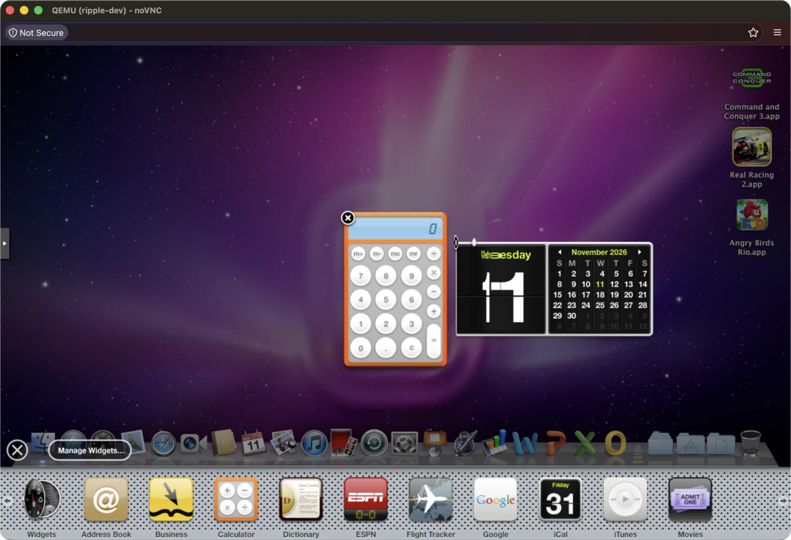
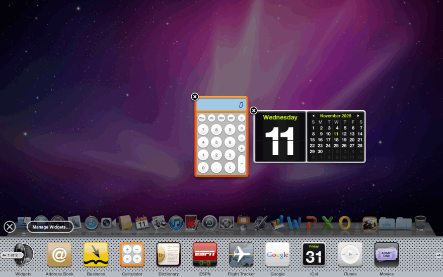
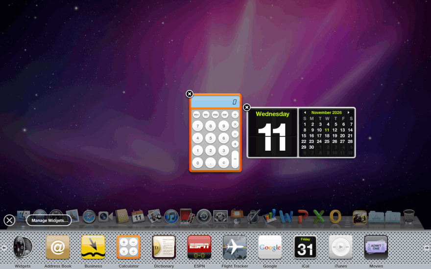

# moose-ripple

<!-- BANNER (to add, made separately): media/banner.png
     Donkey, the plush moose, as a flat cartoon with ripples, on an original purple aurora background:

-->

**Hardware acceleration for Mac OS X 10.6 Snow Leopard virtual machines, using the host GPU.**

Snow Leopard, like Mac OS X in general, has no driver for a virtual GPU, so in a virtual machine
it can only draw with the software renderer. For years I wanted a portable way to see that
Dashboard ripple again in a VM, and now it's finally doable.

This project is a guest driver for QEMU's standard **virtio-gpu** card with **virgl**, the
paravirtual 3D path that hands OpenGL to the host. Snow Leopard sees a graphics card, OpenGL
renders on the host GPU, and WindowServer composites the desktop on it. No period hardware, no
GPU passthrough.



*Snow Leopard's Dashboard on moose-ripple, seen through Proxmox's VNC console.*

moose-ripple is still at an early stage, and it won't replace GPU passthrough. I'm working on
the performance, but translating every call to the host will always leave a gap to a real card
inside the VM.

<!-- PREVIEW (to add): media/gears-menu-bar.png
     gl-gears running with the translucent menu bar in the same shot:

-->

| moose-ripple | Apple's software rendering |
|---|---|
|  |  |

*Adding a widget to the Dashboard, recorded in real time in the same VM: moose-ripple on the
left, Apple's software rendering on the right.*

## What works

- Quartz Extreme: WindowServer composites the whole screen on the GPU. The menu bar and menus
  are translucent over a blurred backdrop, Exposé and Dashboard animate on the GPU, and adding a
  widget sets off the ripple.
- OpenGL 2.1 for apps, 32- and 64-bit, through Mesa's virgl driver. Apps see the renderer as
  `virgl (Mesa Intel(R) UHD Graphics 630 (CFL GT2))` on the test host. Quartz Composer, Front Row,
  the Flurry screen saver and games such as Angry Birds Rio run on it.
- Core Image on the GPU: its filters and Photo Booth's effects.


*Top: Apple's software rendering, an opaque white menu bar. Bottom: moose-ripple, the
translucent menu bar with the desktop showing through. Both from the same VM.*

### Measured

The test machine is a Proxmox VE 8.4 host with an Intel Core i9-9900K and its built-in Intel UHD
Graphics 630. The guest runs at 1280x800 with 4 virtual CPUs. moose-ripple is compared with
Apple's software renderer in the same VM, booted without moose-ripple. Numbers from a real
GeForce 9600 GT passed through to the VM are coming, and perhaps a Radeon HD 5870 later.

| | Apple's software renderer | moose-ripple |
|---|---|---|
| Quartz Composer (Arabesque) | refuses to start | 60 frames/s |
| Angry Birds Rio (32-bit) | refuses to start ("OpenGL 2.0 renderer not supported") | 59 frames/s |
| Flurry screen saver | 29 frames/s, 66% of a CPU | 27 frames/s, 4% of a CPU |
| Dashboard, screens composited per second, peak / mean | 18.7-20 / 7.4-7.9 | 29-30 / 13.6-14.2 |
| Exposé, screens composited per second, peak / mean | 10-11 / 3.6-5.3 | 22-24 / 7.8-11.2 |
| 24 Core Image filters on a 480x300 photo | reference | 23 match; CIEdges differs on 3.9% of pixels |
| 61 Photo Booth effects on the same photo | reference | 55 match; Concert, Neon, Blue Print, Comic Book, Pointillize and Pinch differ |
| Photo Booth effect, time per frame | 2-3 ms | 0.4-0.8 ms for most |
| Core Image filter, time per frame | 1-5 ms | 2-90 ms |

- "Screens composited per second" is WindowServer's own frame meter (the one in Quartz Debug),
  counted in full screens' worth of pixels. Dashboard composites fewer, larger frames than the
  software renderer: 80 / 35-38 frames per second against 90-92 / 38-42.
- "Match" means within 1-2 colour levels of the software renderer, or under 1% of the pixels
  different.
- A single Core Image filter is slower than software for now, because each render is a round
  trip through QEMU. That is on the list for the next performance pass.
- The host GPU's minimum clock was raised to 1200 MHz for these numbers
  (`/sys/class/drm/card0/gt_min_freq_mhz` on Intel). At the default 350 MHz each screen update
  takes about 5 ms longer.

Details: [docs/re/perf-notes.md](docs/re/perf-notes.md) and [docs/re/m6-notes.md](docs/re/m6-notes.md).

### Not working yet

- Real Racing 2: the intro movie draws nothing and the game's own picture is sheared into five
  side-by-side copies ([#8](https://github.com/mizaimao/moose-ripple/issues/8)).
- Chess: the 3D board stays black ([#9](https://github.com/mizaimao/moose-ripple/issues/9)).
- Core Image Fun House shows no image (with Apple's software renderer too).
- iMovie hasn't been tried yet. Photo Booth's live effects need a camera, which the test VM
  doesn't have, so the effects were tested on a still photo ([#11](https://github.com/mizaimao/moose-ripple/issues/11)).
- The OpenGL windows of apps are copied back through the guest every frame: about 20-30 ms per
  frame for a 1280x800 window. The next performance pass keeps them on the GPU ([#10](https://github.com/mizaimao/moose-ripple/issues/10)).
- From a key press to the first change on screen takes about 0.2 s, measured through QEMU's VNC
  display, and whole-screen animations reach a VNC viewer at 4-20 frames/s ([#10](https://github.com/mizaimao/moose-ripple/issues/10)).
- `open -a "Front Row"` starts Front Row without showing it. Start it with Cmd+Esc.
- Only Mac OS X 10.6.8 with the 64-bit kernel. Only tested with an Intel host GPU; virglrenderer
  also runs on AMD and NVIDIA host GPUs, but those haven't been tried yet.

Some problems of 10.6 in QEMU show up without moose-ripple too: a panic when the guest goes to
sleep (KI-6), live snapshots that panic it (KI-5) and the pointer drifting with QEMU's USB tablet
(KI-1). They are in [docs/known-issues.md](docs/known-issues.md), with workarounds.

## Status

| Milestone | What it covers | State |
|---|---|---|
| M0 | Build, deploy and kernel-debug loop from a Linux build host | done |
| M1 | Reverse-engineering spike: Apple's OpenGL plugin and accelerator interfaces | done |
| M2 | Display driver: virtio-gpu framebuffer, any resolution, hardware cursor | done |
| M3 | 3D transport: virgl contexts, resources and command submission from the guest | done |
| M4 | OpenGL 2.1 on the host GPU (Mesa's virgl driver, ported to Snow Leopard) | done |
| M5 | Quartz Extreme: WindowServer composites on the GPU (Exposé, Dashboard ripple, translucent menu bar) | done |
| M6 | Core Image and real apps: Quartz Composer, Core Image filters, Photo Booth effects and Front Row work; Real Racing 2 and iMovie are open | in progress |
| Performance, second pass | App OpenGL windows kept on the GPU, fewer round trips for Core Image | after M6 |

Each milestone measures the numbers above again and must not make them slower. Reports for each
milestone are in [docs/re/](docs/re/).

## Build environment

- [ ] A Linux x86_64 host with KVM. Tested: Proxmox VE 8.4 (Debian 12.10, kernel 6.5.11).
- [ ] QEMU with virgl: the `virtio-vga-gl` device and a display with OpenGL (`egl-headless`,
  `gtk,gl=on` or `sdl,gl=on`). Tested: QEMU 9.2.0 (Proxmox's `pve-qemu-kvm` 9.2.0-5).
- [ ] virglrenderer. Tested: 0.10.4.
- [ ] A host GPU with an OpenGL driver. Tested: Intel UHD Graphics 630 with Mesa 22.3.6
  (Debian 12's).
- [ ] OVMF, QEMU's UEFI firmware. Tested: edk2 2025.02 (Proxmox's `pve-edk2-firmware`
  4.2025.02-3).
- [ ] Mac OS X 10.6.8 (build 10K549) installed in the VM, from your own copy, running the 64-bit
  kernel. OpenCore below starts it that way.
- [ ] OpenCore as the boot loader: the boot disk from [boot/opencore/](boot/opencore/README.md)
  (OpenCore 1.0.8). Other boot loaders are untested.
- [ ] The SMC key of a real Mac, for QEMU's Apple SMC device (`isa-applesmc,osk=...`).

This repository contains no Apple software, firmware or keys. Mac OS X 10.6 (and, to build from
source, Xcode 3.2.6 and its SDK) must come from your own legal copies, and running Mac OS X in a
virtual machine is subject to Apple's license terms.

## Install

What's tested: the steps below on Proxmox VE, including `install.sh` and `uninstall.sh` run from
a CD image in a copy of the test VM. The plain QEMU command line is the same VM written out for
QEMU without Proxmox; it hasn't been run as such yet.

### 1. Build the files

There are no ready-built downloads: build the guest files yourself, as described in
[Building from source](#building-from-source). `make package` puts them in one zip,
`build/moose-ripple-VERSION.zip`, which holds:

| File | What it is |
|---|---|
| `RippleVirtioGPU.kext` | the display and GPU driver (kernel) |
| `RippleGLDriver.bundle` | the OpenGL driver: Mesa's virgl driver for 10.6 |
| `RippleGA.plugin` | the 2D plugin WindowServer needs before it composites with OpenGL |
| `RippleQEMUTablet.kext` | optional: the pointer follows QEMU's USB tablet exactly |
| `qe-check` | prints whether each display has Quartz Extreme |
| `install.sh`, `uninstall.sh` | put the four bundles in place and set the boot flags, or take them out again |
| `INSTALL` | these steps, short |
| `LICENSE`, `LICENSE-Mesa.rst` | moose-ripple's license, and Mesa's for the Mesa code in the GL driver |
| `SHA256SUMS` | checksums of all the files (`install.sh` checks them first) |

Hand the files to the guest as a CD image:

```
unzip moose-ripple-VERSION.zip
genisoimage -V RIPPLE -r -J -o ripple.iso moose-ripple-VERSION   # or: xorriso -as mkisofs, same options
```

The OpenCore boot disk has its own build: [boot/opencore/](boot/opencore/README.md).

### 2. Set up the VM

#### Proxmox VE (tested)

With the OpenCore disk as `ide0` and the Snow Leopard disk as `sata0`:

```
qm set VMID --machine pc-q35-7.2 --bios ovmf --cpu Penryn --cores 4 --memory 8192 \
    --vga virtio-gl --tablet 1 --net0 e1000,bridge=vmbr0 --ostype other \
    --efidisk0 local:1,format=qcow2,efitype=4m,pre-enrolled-keys=0
qm importdisk VMID opencore.qcow2 local --format qcow2   # attach the disk it prints as ide0
qm set VMID --boot order=ide0
qm set VMID --args '-device isa-applesmc,osk="YOUR-SMC-KEY" -smbios type=2 -cpu Penryn,kvm=on,vendor=GenuineIntel,+sse4.1,+sse4.2,+ssse3,+kvm_pv_unhalt,+kvm_pv_eoi,+hypervisor,+invtsc,vmware-cpuid-freq=off -global ICH9-LPC.acpi-pci-hotplug-with-bridge-support=off -device usb-kbd,bus=ehci.0,port=4 -fw_cfg name=opt/ovmf/X-PciMmio64Mb,string=0'
```

`vga: virtio-gl` needs `libgl1` and `libegl1` on the Proxmox host (`apt install libgl1 libegl1`).
The Proxmox console then shows the guest through VNC.

#### Plain QEMU (not tested yet)

```
cp /usr/share/OVMF/OVMF_VARS_4M.fd snowleopard-vars.fd    # OVMF's paths differ between distributions
qemu-system-x86_64 \
  -machine pc-q35-7.2,accel=kvm -m 8192 -smp 4 \
  -cpu Penryn,kvm=on,vendor=GenuineIntel,+sse4.1,+sse4.2,+ssse3,+kvm_pv_unhalt,+kvm_pv_eoi,+hypervisor,+invtsc,vmware-cpuid-freq=off \
  -device isa-applesmc,osk="YOUR-SMC-KEY" -smbios type=2 \
  -global ICH9-LPC.acpi-pci-hotplug-with-bridge-support=off \
  -drive if=pflash,format=raw,readonly=on,file=/usr/share/OVMF/OVMF_CODE_4M.fd \
  -drive if=pflash,format=raw,file=snowleopard-vars.fd \
  -fw_cfg name=opt/ovmf/X-PciMmio64Mb,string=0 \
  -device virtio-vga-gl -display gtk,gl=on \
  -device ich9-usb-ehci1,id=ehci -device usb-kbd,bus=ehci.0 -device usb-tablet,bus=ehci.0 \
  -drive file=opencore.qcow2,if=none,id=oc,format=qcow2 -device ide-hd,bus=ide.0,drive=oc,bootindex=0 \
  -drive file=snowleopard.qcow2,if=none,id=sl,format=qcow2 -device ide-hd,bus=ide.1,drive=sl \
  -drive file=ripple.iso,if=none,id=cd,media=cdrom -device ide-cd,bus=ide.2,drive=cd \
  -netdev user,id=net0 -device e1000,netdev=net0
```

Proxmox uses `-display egl-headless,gl=core` with a VNC console instead of `gtk,gl=on`.

#### Why these settings

- `vmware-cpuid-freq=off`: without it OpenCore reads the wrong bus clock and the guest's clock
  runs 10% slow.
- `X-PciMmio64Mb=0`, plus the boot flag `npci=0x2000` in step 4: 10.6 can't reach the GPU's
  memory when the firmware or the guest places it above 4 GB.
- `usb-kbd`: 10.6 has no PS/2 keyboard driver.
- Exactly one `isa-applesmc`: two make 10.6 panic at boot.
- `pc-q35-7.2`: the machine version we tested.

More on the boot disk: [boot/opencore/README.md](boot/opencore/README.md).

### 3. Prepare Snow Leopard

- If 10.6.8 isn't installed yet: start the 10.6.3 retail DVD through OpenCore, install, then
  apply the 10.6.8 combo update. Until moose-ripple is in, the virgl card works as a plain
  display (Apple's boot framebuffer, no acceleration).
- Turn sleep off, because 10.6.8 in QEMU panics when it goes to sleep with more than one CPU:
  `sudo pmset -a sleep 0 displaysleep 0 disksleep 0`.
- Take a snapshot of the VM.

### 4. Install the files in the guest

Attach `ripple.iso` as a CD (on Proxmox: upload it to an ISO storage, then
`qm set VMID --ide2 local:iso/ripple.iso,media=cdrom`). It appears as `/Volumes/RIPPLE`. Then,
in Terminal:

```
cd /Volumes/RIPPLE
sudo sh install.sh               # or: sudo sh install.sh --no-tablet
sudo reboot
```

`install.sh` stops with a message if the guest isn't 10.6.8 on the 64-bit kernel or a checksum
doesn't match. Otherwise it does what you would do by hand:

1. Copies `RippleVirtioGPU.kext`, `RippleGLDriver.bundle`, `RippleGA.plugin` and
   `RippleQEMUTablet.kext` into `/System/Library/Extensions`.
2. Makes them owned by `root:wheel` and read-only for others (`chmod -R u=rwX,go=rX`): 10.6
   refuses kexts with any other owner.
3. Checks the kernel driver with `kextutil -n -t RippleVirtioGPU.kext` ("appears to be
   loadable").
4. Rebuilds the kext cache with `kextcache -system-mkext`, run from `/` (from a folder on a CD
   it fails with "Couldn't lock").
5. Adds `npci=0x2000 ripple_gl=1 ripple_qe=1` to the boot flags with `nvram boot-args`,
   keeping the flags already there.

The boot flags:

| Flag | Meaning |
|---|---|
| `npci=0x2000` | keeps PCI memory below 4 GB. Always keep it. |
| `ripple_gl=1` | OpenGL through moose-ripple. Without it the kext only drives the display (any resolution, no 3D). |
| `ripple_qe=1` | Quartz Extreme. Needs `ripple_gl=1`. |
| `-v` | text instead of the grey Apple screen while booting. Optional. |
| `slto_us=4000000` | optional: add it if you take snapshots of the running VM ([KI-5](docs/known-issues.md)). |
| `ripple_hwcursor=1` | optional: the pointer as a hardware cursor. QEMU's own window then draws it without lag; VNC consoles draw their own. |

The flags are kept in the VM's UEFI variables (Proxmox's efidisk, or the VARS file with plain
QEMU), so they survive restarts.

### 5. Check that it works

- The menu bar is translucent. Press F12 and drag a widget out of the widget bar: the water
  ripples.
- `/Volumes/RIPPLE/qe-check` prints `QE on` for each display.
- `ioreg -l -c RippleAccelerator | grep -E '"Ripple(GL|QE)"'` shows both as `on`.

### Removing it

```
cd /Volumes/RIPPLE
sudo sh uninstall.sh
sudo reboot
```

It removes the four bundles, rebuilds the kext cache and takes the `ripple_` flags out of the
boot flags (`npci=0x2000` stays). If the VM doesn't reach the desktop, go back to the snapshot,
or start it in single-user mode (Cmd+S in OpenCore's menu) and run `/sbin/mount -uw /`,
`rm -rf /System/Library/Extensions/Ripple*` and `reboot`.

## Building from source

The guest files build on Linux, cross-compiled for Mac OS X 10.6:

```
make package                    # build/moose-ripple-VERSION.zip, the files for step 1 of Install
make virtiogpu glbundle gaplugin qemutablet qecheck     # only the files, in build/
```

The results land in `build/`.
What the build needs, under the repository's git-ignored `.tools/` and `.venv/`:

- clang, targeting `i386-apple-darwin10` and `x86_64-apple-darwin10`. Tested: clang 19.1.7 on
  Debian 13.
- [cctools-port](https://github.com/tpoechtrager/cctools-port), branch `973.0.1-ld64-609`, built
  into `.tools/cctools` (its `ld`, `lipo` and `vtool`).
- `MacOSX10.6.sdk` from Xcode 3.2.6 in `.tools/sdk/`, from your own copy.
- For the OpenGL driver: meson, ninja, and Python with mako, pyyaml and packaging in `.venv`.
  `gldriver/mesa/build.sh` downloads Mesa 24.3.4, applies [gldriver/mesa/patches/](gldriver/mesa/patches/)
  and builds both architectures ([gldriver/mesa/](gldriver/mesa/README.md)).

The OpenCore boot disk has its own build: [boot/opencore/](boot/opencore/README.md). Why the
toolchain looks like this: [decision 0001](docs/decisions/0001-toolchain.md) and
[decision 0009](docs/decisions/0009-mesa-for-10.6.md).

Our own development loop is in `scripts/`. It builds on a Linux host over ssh and installs into a
Proxmox VM, taking a snapshot first (`build.sh`, `install-kext.sh`, `install-glbundle.sh`,
`bootargs.sh`, `qe-check.sh`). Its settings (host, VM ID, guest user and key) are at the top of
[scripts/lib.sh](scripts/lib.sh).

## How it works

```
 Guest: Mac OS X 10.6.8
 ┌───────────────────────────────────────────────────────────────┐
 │ Apps, WindowServer, Core Image, Core Animation                │
 │      │ OpenGL / CGL                       │ 2D blits          │
 │ RippleGLDriver.bundle                RippleGA.plugin          │
 │  Mesa virgl driver + a CGL front end  (WindowServer's         │
 │      │ IOKit user client               graphics accelerator)  │
 ├──────┼────────────────────────────────────────────────────────┤
 │ RippleVirtioGPU.kext                                          │
 │  virtio transport, framebuffer and cursor, accelerator        │
 │  surfaces, virgl contexts, resources and fences               │
 └──────┬────────────────────────────────────────────────────────┘
        │ virtio-gpu (virgl)
 Host:  QEMU (virtio-vga-gl) ─► virglrenderer ─► host OpenGL ─► any GPU
```

- `RippleVirtioGPU.kext` drives the virtio-gpu card: display modes, scanout, the hardware
  cursor, and the 3D commands the GL driver sends. To Snow Leopard it looks like a graphics
  card with an accelerator.
- `RippleGLDriver.bundle` is an OpenGL renderer plugin, loaded by Apple's OpenGL framework like
  any vendor driver. Inside is Mesa's virgl Gallium driver, built for 10.6.
- `RippleGA.plugin` gives WindowServer the 2D blitter it asks for before it will composite the
  screen with OpenGL.
- `RippleQEMUTablet.kext` (optional) makes QEMU's USB tablet work as an exact absolute pointer.

The boundary between the GL bundle and the kernel is small, versioned and GPU-neutral:
[docs/kext-uapi.md](docs/kext-uapi.md). The design and the plan are in
[HANDOFF.md](HANDOFF.md), the decisions in [docs/decisions/](docs/decisions/).

## Credits

moose-ripple builds on:

- [Mesa](https://mesa3d.org) and its virgl Gallium driver (MIT), the GL implementation inside
  RippleGLDriver.bundle.
- [virglrenderer](https://gitlab.freedesktop.org/virgl/virglrenderer) (MIT), which runs the
  guest's GL on the host. Its protocol headers are in [third_party/virgl](third_party/virgl).
- [QEMU](https://www.qemu.org) and its virtio-gpu device. The virtio headers from Linux are in
  [third_party/virtio](third_party/virtio), with their own licenses.
- [OpenCore](https://github.com/acidanthera/OpenCorePkg) (BSD-3-Clause), the boot loader.
- [cctools-port](https://github.com/tpoechtrager/cctools-port), the Mach-O linker that lets a
  Linux box build 10.6 kexts.

Prior art, studied but no code used: VMsvga2 (VMware SVGA driver for OS X guests, by Zenith432)
and Virtual Intel Mac (OpenGL forwarding for Intel macOS guests on Apple-silicon hosts). Notes:
[docs/re/prior-art.md](docs/re/prior-art.md).

## License

MIT, see [LICENSE](LICENSE). Files in `third_party/` keep their own licenses.
