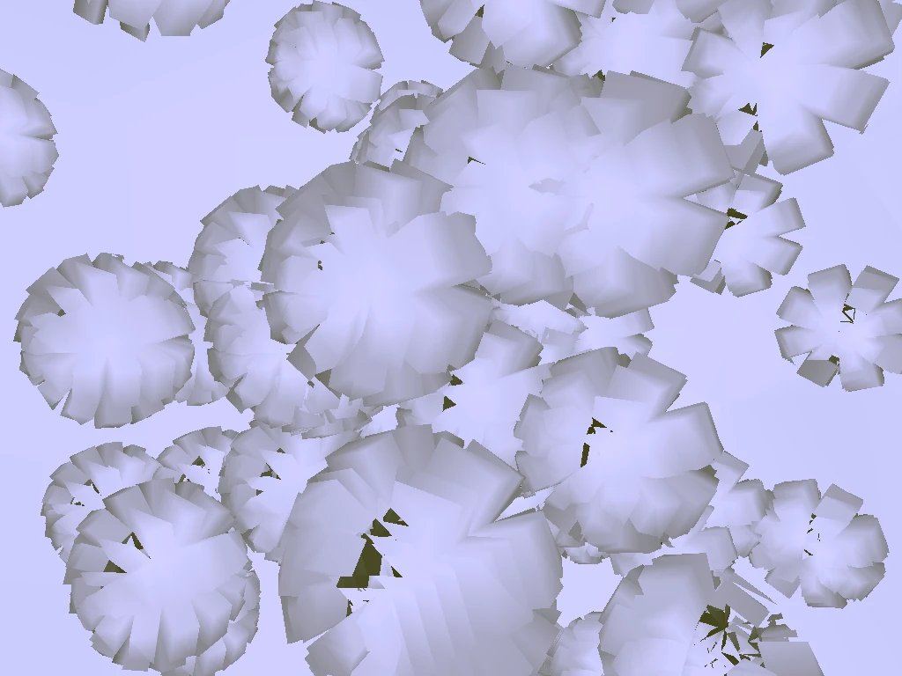
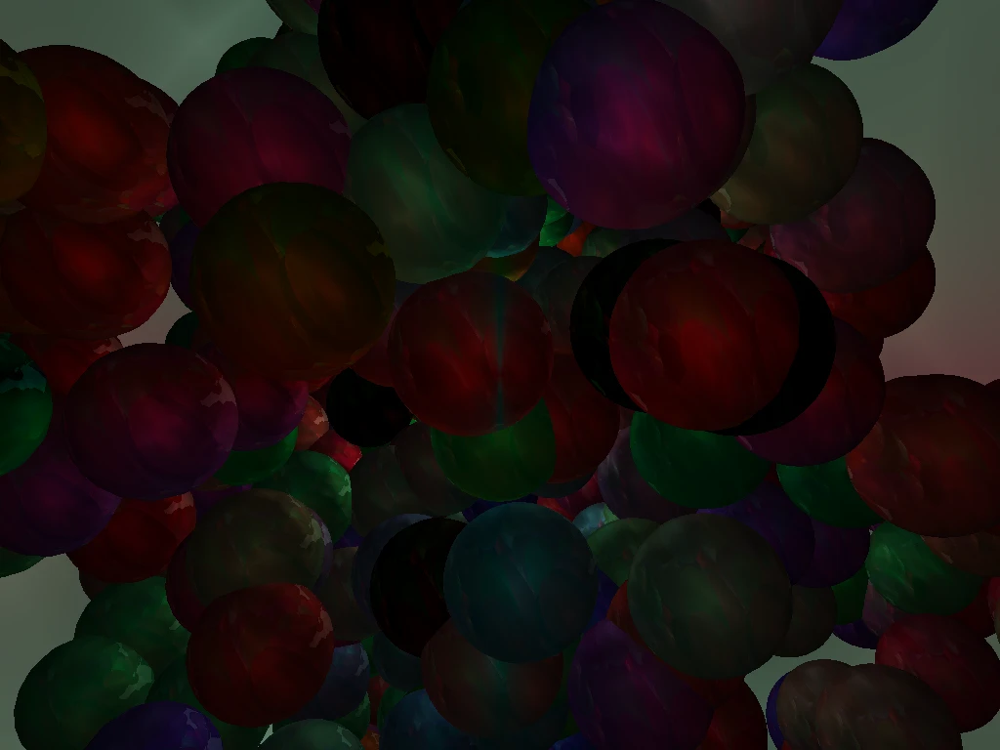

# Mesa on Windows 7

Does Mesa 24.3.4, the release the Mac side uses, build for Windows 7 and run there, before
any driver of ours exists? Yes, with software rendering: Mesa's OpenGL draws in the Windows 7
test VM, and its Direct3D 10 driver (`libgallium_d3d10.dll`) gives a working Direct3D 10
device through Windows 7's own Direct3D runtime. 2026-11-14.

## Build

`windows/mesa/build-win7.sh`, on the Linux build host:

- Source: the release tarball (`mesa-24.3.4.tar.xz`, the same sha256 as the Mac side), unpacked
  into its own tree `.tools/mesa/src-24.3.4-win` and built in `.tools/mesa/build-win7-x64`, so
  nothing of the Mac side's tree or builds is touched. Patches in `windows/mesa/patches/`.
- Toolchain: llvm-mingw 20261104 (clang 23.1.5), the variant that links against `msvcrt.dll`,
  since Windows 7 has no Universal C runtime unless an update adds it. Downloaded into
  `.tools/llvm-mingw` from
  `https://github.com/mstorsjo/llvm-mingw/releases/download/20261104/llvm-mingw-20261104-msvcrt-ubuntu-22.04-x86_64.tar.xz`
  (83 MB, sha256 `6e3342e2e0dfa56e9178f3c34b198f278bd5e603db4a759455d1439cc2230630`).
- Options: `-Dplatforms=windows -Dmin-windows-version=7 -Dgallium-drivers=softpipe
  -Dgallium-d3d10umd=true -Dopengl=true`, LLVM off, no Vulkan, no GLES or EGL.
  `min-windows-version=7` makes Mesa use its own futex replacement instead of
  `WaitOnAddress` (Windows 8). Mesa's `meson.build` still defines `_WIN32_WINNT=0x0A00`; that
  only unlocks declarations, and the DLLs import nothing newer than Windows 7 (below).
- Direct3D 10 headers: Mesa's `d3d10umd` wants the WDK's DDI headers in `include/winddk`
  (its `README.txt` lists them). The build copies them from WDK 7.1 (`d3d10umddi.h`,
  `d3dumddi.h`, `d3dkmthk.h`, `d3dkmddi.h`, `d3dkmdt.h`, `d3dukmdt.h`, `dxgiddi.h`,
  `dxgiformat.h`, `dxgitype.h`, `dxmini.h`, `wmidata.h` and the two tokenized program format
  headers) into the build's own tree; they are never committed.

What had to change:

| Where | Change | Why |
|---|---|---|
| Compiler flags | `-Wno-error=incompatible-pointer-types` | clang 23 makes it an error; Mesa's SPIR-V code passes a `jmp_buf` to MinGW's `__builtin_setjmp` |
| Local copy of `d3d10umddi.h` | `MAKE_##TYPE##(` becomes `MAKE_##TYPE(` | only MSVC accepts the second paste |
| Local copy of `d3d10umddi.h` | its global `const UINT`/`const INT` constants made `static` | in C files they are duplicate symbols; with MSVC Mesa hides them by including `d3d10_1.h` first |
| `patches/0011-x86-aligned-matrix-stack.patch` | the GL matrix stacks allocated 16-byte aligned | 32-bit only: `msvcrt.dll` aligns `calloc` to 8 bytes (below) |
| `patches/0010-win7-wdk71-d3dkmt-and-gdi.patch` | `D3DKMTPresent` takes a const pointer; `KMTQAITYPE_XBOX`, `KMTQAITYPE_PHYSICALADAPTER*` and `D3DKMTSetVidPnSourceOwner1` left out at the Windows 7 interface version; two helpers in `d3d10_gdi.c` made `static` | WDK 7.1's headers are older than the ones Mesa is written against |

Result, in `.tools/mesa/out-win7-x64`: `opengl32.dll` (199,680 bytes), `libgallium_wgl.dll`
(16 MB), `libglapi.dll`, `libgallium_d3d10.dll` (8.7 MB). Their imports are only
`KERNEL32`, `USER32`, `GDI32` and `msvcrt`, plus each other; C++ is linked in statically.

## In the Windows 7 test VM

VM 220 (Windows 7 SP1 x64, the Standard VGA adapter, [test-vms.md](test-vms.md)), with two
small test programs built by llvm-mingw (`tools/win7-hello/gltest.c` and `d3d10test.c`):

| Test | Result |
|---|---|
| `gltest.exe` with Windows' own `opengl32.dll` | Microsoft, GDI Generic, OpenGL 1.1.0; the triangle is red |
| `gltest.exe` with Mesa's `opengl32.dll` next to it | Mesa, softpipe, OpenGL 3.3 (Compatibility Profile) Mesa 24.3.4; the triangle is red (255 0 0 read back) |
| `d3d10test.exe`: `D3D10CreateDevice(D3D10_DRIVER_TYPE_SOFTWARE)` on `libgallium_d3d10.dll` | device created; the render target cleared to green, a triangle drawn with a vertex and a pixel shader, copied to a staging texture and mapped: 255 0 0 255 inside the triangle, 0 255 0 255 outside |

The shaders are `tools/win7-hello/tri.hlsl` (vertices made from `SV_VertexID`, no vertex
buffer), compiled to DXBC for `vs_4_0` and `ps_4_0` by `hlsl2dxbc.c` with `D3DCompile` from
Wine 10's `d3dcompiler_47.dll` (which uses vkd3d-shader) on the build host, and embedded in the
test as `tri_vs.h` and `tri_ps.h`. Windows 7's runtime accepted the blobs.

So Mesa's Direct3D 10 user-mode driver loads under Windows 7's Direct3D 10 runtime, creates a
device, and its resource, clear, shader, draw, copy and map paths work. Not covered yet:
Direct3D 10.1 and its 9.x feature levels (what the desktop compositor uses), and the DXGI
present path.

## 32-bit

`ARCH=x86 windows/mesa/build-win7.sh` builds the same four DLLs for 32-bit Windows
(`.tools/mesa/build-win7-x86`, `out-win7-x86`); again only `KERNEL32`, `USER32`, `GDI32` and
`msvcrt` imports, and `OpenAdapter10` exported undecorated. Tested in VM 220 as 32-bit
programs (WOW64 on Windows 7 x64; there is no 32-bit Windows 7 VM):

- Direct3D 10: the same results as on x64, shader draw included.
- OpenGL first crashed in `libgallium_wgl.dll` (access violation in `_math_matrix_ctr`, an
  aligned SSE store): the GL matrix stacks come from `calloc`/`realloc`, which `msvcrt.dll`
  aligns to 8 bytes on 32-bit Windows, while `GLmatrix` is `alignas(16)`. Patch
  `0011-x86-aligned-matrix-stack.patch` allocates them with Mesa's `align_calloc`/
  `align_realloc`/`align_free`; with it the GL test draws (softpipe, OpenGL 3.3, the triangle
  red). Other `alignas(16)` structures on the plain heap could show the same on 32-bit.

## The Yttrium fork (Mesa 26.1) on Windows 7

Tried once (2026-11-14) to see whether a newer Mesa would do: `virtio-win-mesa` at 76c095b,
the same options, without Yttrium's own driver. It does not build against WDK 7.1's headers.
Core Mesa compiles; what breaks: a new shared helper (`src/gallium/auxiliary/gdikmt`, part of
`libgallium` on Windows, so OpenGL too) includes `d3dkmthk.h` without the DDK include path,
WDK 7.1's `d3dkmthk.h` needs SAL annotations the tree no longer defines, and the Direct3D
10/9 code uses Windows 8 and later DDI types (`D3D11_1_DDI_BLEND_DESC`,
`D3D11_1_DDI_LOGIC_OP_*`, `DXGI_DDI_ARG_PRESENT1`, `BLT1`, `OFFERRESOURCES`,
`RECLAIMRESOURCES`, the multiplane overlay calls). The Windows side therefore stays on Mesa
24.3.4; the fork's Direct3D 9 part (MIT) is to be carried back to it.

## The virgl variant: the Mesa side of virtio-win pull request 943

`VARIANT=virgl windows/mesa/build-win7.sh` builds Mesa's virgl driver for Windows 7 x64 as the
user-mode half of a virtio-gpu display driver: `viogpu_wgl.dll` (OpenGL, through Mesa's own
`opengl32.dll` or as the display driver's OpenGL client driver) and `viogpu_d3d10.dll`
(Direct3D 10 and 10.1). It cannot draw until the kernel driver exists; what is checked so far is
that it builds and loads.

Source (in `windows/mesa/patches-virgl/`, applied only for this variant, in its own source tree
`.tools/mesa/src-24.3.4-win-virgl`): the five commits by Max R on `viogpu_win` of
`gitlab.freedesktop.org/max8rr8/mesa`
(Mesa merge request 24223), on top of upstream 366e7e2ddc7. They apply to 24.3.4 unchanged:

| Patch | What it does | Licence of what it adds |
|---|---|---|
| `0001-viogpu-wgl-WGL-GDI-Framebuffer-improvements` | WGL: framebuffer handling for a GDI-presenting driver | changes to MIT files |
| `0002-viogpu-gdikmt-Introduce-gdikmt` | the build hooks and a new handle type for the kernel bridge, **without the bridge itself** (below) | changes to MIT files |
| `0003-viogpu-d3d10umd-Viogpu-for-windows-improvements` | the Direct3D 10 driver: talks to a kernel driver through the bridge, formats, DXGI present | changes to MIT files |
| `0004-viogpu-virgl-gdi-Introduce-virgl-winsys-for-windows` | virgl's winsys for Windows (`winsys/virgl/gdi`), and the private kernel interface header `src/virtio/wddm/viogpu_wddm_driver.h` | winsys: MIT (Red Hat header); interface header: BSD-3-Clause (Red Hat) |
| `0005-viogpu-targets-Add-virgl-to-wgl-and-d3d10-targets` | virgl in the WGL and Direct3D 10 targets; `dxgi_framebuffer.cpp` | MIT (Microsoft header, from Mesa's d3d12 WGL code) |

Scanned for GPL, LGPL and MPL text: none in any patch. Four files of commit 77e160421bd, the
kernel bridge `gdikmt` (`auxiliary/gdikmt/gdikmt.h`, `gdikmt_d3dkmt.c`,
`frontends/d3d10umd/gdikmt_d3dddi.cpp`, `gdikmt_d3dddi.h`), carry no licence header at all.
Decision (2026-11-14): we write our own bridge; those four files are never committed. Ours is
in `windows/mesa/overlay-virgl/` (MIT, same four file names, written from the description in
"What the rest expects from the kernel bridge" below): the build copies it over the source
tree after the patches, and the source tree's stamp covers it, so a change to it unpacks the
tree again.

Our patches on top: `0010` and `0011` as above, `0012` (the DDK headers on the include path of
the bridge, the virgl winsys and the WGL target: with MinGW, `d3dkmthk.h` comes from
`include/winddk`), `0013` (a pointer-to-handle cast clang rejects on 64-bit), `0014` (the
Windows 7 completion event and which allocations belong to the runtime, below), `0015` (`bool`
for the `boolean` type Mesa has dropped, which the winsys still used: the original bridge header
defined it, ours does not). The build also leaves WDK 7.1's `dxgiformat.h` and `dxgitype.h` out
of `include/winddk`, so the DXGI framebuffer code sees MinGW's newer ones, and has the local
`d3dkmthk.h` include Mesa's `winddk_compat.h` (empty SAL annotations) itself.

Result: `viogpu_wgl.dll` imports only `GDI32`, `KERNEL32`, `USER32`, `msvcrt` and
`libglapi.dll`; `viogpu_d3d10.dll` only `KERNEL32` and `msvcrt`. The bridge loads the D3DKMT
functions from `gdi32.dll` at run time, so nothing Windows 7 lacks is imported. In VM 220 both
load with all imports resolved (`tools/win7-hello/dllload.c`); `OpenAdapter10`,
`OpenAdapter10_2`, `DrvCreateContext`, `DrvSetPixelFormat` and `DrvValidateVersion` are there.

Windows 8 and later assumptions found:

- Command completion: after each submission the bridge asks the kernel to signal a CPU event
  when the GPU is done, through `SignalSynchronizationObject2` with a CPU event (the D3DKMT
  function from `gdi32` on the OpenGL path, the runtime's callback of the same name on the
  Direct3D path). Both are WDDM 1.2 (Windows 8). On Windows 7 (`0014`) the winsys ends the
  command buffer with a command of the kernel driver's private protocol,
  `VIOGPU_CMD_SIGNAL_EVENT`, and the kernel driver sets the event when the buffer has run on the
  host; with no room left for that command, the event is set at submission.
- Nothing else: the Direct3D driver reports the Direct3D 10.0, 10.0.x, 10.0.7 and 10.1 DDI
  versions only, which Windows 7's runtime has.

The private protocol between these DLLs and the kernel driver (escape packets for resource
info and busy state, and the per-allocation data exchanged at allocation creation and open) is
in `viogpu_wddm_driver.h` and must match the kernel driver (`windows/kmd`).

### What the rest expects from the kernel bridge

Described from how the other patches use it, for writing our own (names as the callers use
them; nothing taken over from the four files):

- A device object standing for one adapter and device in the kernel driver, with a table of
  operations, and two ways to make one: from a window's device context (`gdikmt_create_from_hdc`,
  used by the WGL target: open the adapter behind the HDC and create a device on it with the
  D3DKMT functions), and from the Direct3D runtime (`gdikmt_d3dddi_fill_basefuncs`, used when
  the Direct3D driver creates its device: the same operations, carried out through the runtime's
  device callbacks and handle; the Direct3D device keeps this bridge device in its own state as
  `gdikmt_device_d3dddi`).
- Device operations the virgl winsys calls: query adapter information (driver-private data),
  escape (driver-private packets), create allocations for a resource (in: count, per-allocation
  info, resource-level private data; out: resource handle), destroy them, open shared
  allocations from a global handle (in: handle, count, per-allocation open info, private data;
  plus a buffer for all private data), query a shared allocation, lock an allocation for CPU
  access, create a context, present, destroy; the Direct3D side also uses flush, and set display
  mode for DXGI's present.
- A context object holding the current command buffer, allocation list and patch-location list
  with their sizes, with a submit operation (`gdikmt_render`): command offset and length, the
  number of allocations and patch locations used, the sizes wanted for the next buffers with
  flags to grow each, and an optional event to signal on completion. After a submit the context
  points at the buffers the kernel hands back.
- Helper entry points with the same shape as the operations: `gdikmt_createallocation`,
  `gdikmt_openallocation`, `gdikmt_render`.

## The Direct3D 9 part (2026-11-15)

Windows 7 programs that use Direct3D 9, and Windows' own assessment tool, need a Direct3D 9
user-mode driver. Ours is the one of the Yttrium project's Mesa fork (its `virtio-win-mesa`
at commit 76c095b, Mesa 26.1.0; `docs/windows/yttrium-notes.md`): the ten files
`src/gallium/frontends/d3d10umd/D3D9*`, all MIT, by Ake Rehnman, with the shader translator
taken from Mesa's "nine" (MIT, Joakim Sindholt and Christoph Bumiller). They are in
`windows/mesa/overlay-virgl/` with their notices, and are built into the same DLL as the
Direct3D 10 driver, which then also exports `OpenAdapter` (patch 0019).

What was changed to bring them from that tree to Mesa 24.3.4 on virgl:

- **The renderer underneath.** The files call that project's own renderer in a dozen places
  and include two of its headers (MPL-2.0, not used here). `D3D9Host.h` and `D3D9Host.cpp`
  (ours) answer the same calls for virgl: a flush is a flush, the rest has nothing to answer.
  The multisample counts and the anisotropy limit, which came from that renderer, are fixed
  for now: no multisampling, 16 samples of anisotropic filtering (Windows 7's Direct3D 9
  wants that many for a hardware device, `docs/windows/kmd-port-notes.md`).
- **Mesa 26.1 to 24.3.** Capability lookups by function instead of the screen's tables;
  one more argument to `set_sampler_views`, `set_constant_buffer` and `ureg_tex_insn`;
  framebuffer and clear surfaces created as objects instead of held by value; three small
  helpers that 24.3 lacks (`D3D9Compat.h`, ours).
- **The kernel bridge** (`gdikmt_d3dddi`, ours) learned what a Direct3D 9 device needs:
  presents go through the device's own present callback with the destination the runtime
  names, and an opened resource is described in Direct3D 9's structure.
- **The kernel driver's allocation data** has no blob memory flag and no stride on Windows 7;
  the two places that read them use what the format says.

Two faults showed in the host's log at the first test, both for resources Gallium allows and
virglrenderer 0.10 refuses, and both are put right in the virgl driver (patch 0020): a texture
without any binding (the Direct3D 9 code reads pictures back through such textures), and a
sample count of one for "not multisampled" (the same thing patch 0016 met in the Direct3D 10
driver).

**First test** (`tools/win7-hello/d3d9test.c`, test VM, Aero on): a hardware device with
vertex processing in the driver is created in a window, the back buffer cleared to green, a
red triangle drawn from screen-space vertices, the picture read back (right in both colours)
and presented: the window shows it. Nothing in the host's log.

Not looked at yet: everything beyond that test. The fork's notes say what to expect
(`docs/windows/yttrium-notes.md`): fixed-function drawing leans on the Direct3D 9 runtime
turning it into shaders, user clip planes are not switched on, and every draw creates and
destroys its state objects, which on virgl is a command to the host each.

### What Windows' own assessments found (2026-11-15)

Windows' assessment tool (`winsat`, the Windows Experience Index) was the first real user of
the Direct3D 9 part, and of more of the Direct3D 10 part than the compositor needs. Each of
these stopped it; in the order met, with how it was found:

| Seen | Cause | Where it was put right |
|---|---|---|
| The tool crashed inside Direct3D 9 when it freed a resource | Every allocation was tied to the runtime's resource; virgl's winsys frees some later, when that resource is gone | Only primaries and shared resources are tied (`D3D9Resource.cpp`, `D3D9Host.cpp`) |
| It crashed in our winsys during a draw (call chain read from a crash dump, `tools/win7-debug/dumpstack.py`) | Mesa 24.3 takes over a reference to each bound vertex buffer, 26.1 takes none | One reference added per buffer (`D3D9Draw.cpp`) |
| Texture tests ended at once | Three 16-bit formats listed and not creatable | Mapped (`D3D9Resource.cpp`) |
| Every Direct3D 10 test: "out of memory" | Direct3D's 24-bit depth with stencil exists on the host only in the other order | The screen is asked which order it has (patch 0022) |
| A Direct3D 10 test drew nothing and "ran" at 12 000 frames a second | Indexable temporaries of a shader not declared as arrays; the host could not compile it and dropped the context | Declared as arrays (patch 0024) |
| The same, for any program that cleared its device state | An end of a render condition that was never begun is an error on the host | Not sent (patch 0023) |
| Video playback never started | The driver listed two video formats it cannot make, and answered "not implemented" to "how many video processors" | Formats not listed; the counts answered with none, so Windows uses its own software processor (`D3D9Adapter.cpp`) |
| Blue screen when playback did start | The kernel driver's scan-line call was a debugging trap | A scan line worked out from the vertical-blank thread (`windows/kmd`, `GetScanLine`) |

The last three kinds have one thing in common worth remembering: **the host renderer answers
some mistakes by silently dropping everything a context draws afterwards**, and the guest
sees no error. Its log (the VM host's journal) is the place to look first when a program runs
and shows nothing, or runs absurdly fast.

Tools that came out of it: the driver's own log (`RIPPLE_UMD_LOG=FILE` in the program's
environment), a trace of every Direct3D 9 call into the driver with its result
(`RIPPLE_UMD_TRACE=1` for failed calls, `2` for all), `dumpstack.py` for crash dumps and
for dumps of a waiting program (`tools/win7-hello/dumpproc.c` writes those).

### The Windows Experience Index (load test 16, 2026-11-15)

A fresh test VM, the package as the repository builds it (kernel driver, one user-mode DLL
with the Direct3D 9 and Direct3D 10 parts), one reboot, then `winsat formal`: it runs to the
end and Windows shows scores. Before this driver the index could not be computed on the test
VM at all. Stock virglrenderer 0.10.4 on the host, nothing in its log during the run. (The
comparison is the assessment the disk kept from 2025, on a passed-through Radeon of the HD 5800
series; it was first written down here as the GeForce 9600 GT's.)

| | Ours | Radeon HD 5800 series, same disk (2025) |
|---|---|---|
| Graphics (desktop, Aero) | 4.6 | 7.8 |
| Gaming graphics | 5.6 | 7.8 |
| Processor, memory, disk | 7.7, 7.9, 7.9 | 7.7, 7.9, 7.9 |
| Video memory throughput | 4 138 MB/s | 57 925 MB/s |

The assessment's own frame rates, 1280x1024: Direct3D 9 Batch 81, Alpha 80, ALU 55, Texture
load 52; Direct3D 10 Batch 96, Alpha 95, ALU 60, Texture load 47, Geometry 88 and 29,
Constant buffer 45; video playback 143 frames with a decode time of 0.66 s. Nothing has been
done for speed yet: the Direct3D 9 part still creates and destroys its state objects for
every draw, and both parts seem to stop near 80 to 96 frames a second whatever is drawn,
which points at a wait per frame. That is for the performance pass.

The wait was the kernel driver's: one command buffer at a time, each part waited for. With
several buffers in flight (load test 23, `docs/windows/kmd-port-notes.md`, "Command buffers
in flight") the scores are 6.1 for graphics and 6.1 for gaming graphics, and the frame rates
Direct3D 9 Batch 482, Alpha 502, ALU 280, Texture load 258; Direct3D 10 Batch 140, Alpha
129, ALU 89, Texture load 85, Geometry 135 and 30, Constant buffer 84.

### DirectDraw, DirectX 7 and 32-bit programs (2026-11-15)

DirectX's own diagnostics (`dxdiag`) said "Direct3D: Not Available" while Direct3D 9 and 10
both ran. Three things were behind it:

1. **dxdiag is a 32-bit program, and so are most programs and games for Windows 7.** A 32-bit
   program needs a 32-bit build of the user-mode driver, in `SysWOW64`, named in the driver
   key as `UserModeDriverNameWow`. The package had none. `ARCH=x86 windows/mesa/build-win7.sh`
   builds it; the INF now installs it and names it.
2. **The 32-bit driver knew nothing of the host.** The request for the host's capability set
   carries a pointer, so its packet was four bytes shorter in a 32-bit program and the 64-bit
   kernel driver refused it. With no capabilities every primitive counted as unsupported, and
   the first draw converted primitives in circles until the stack was full. The field is
   eight bytes in every build now (patch 0026 and `windows/kmd/shared/viogpum.h`).
3. **DirectDraw asks the Direct3D 9 driver older questions** (it opens the driver with
   interface version 7 and asks for the DirectX 3 and DirectX 7 capability blocks). The
   driver left the DirectX 7 one unanswered, and DirectDraw then runs on software without a
   word. The answer, and the DirectX 7-era drawing that programs then expect, come from
   vmlab-win3d (<https://github.com/VMLabDev/vmlab-win3d>, MIT, commit b7e5451): its patches
   0006 (the Direct3D 9 files' part), 0012, 0013, 0014, 0024, 0035 and 0040 to 0044, merged
   into our copies of the Direct3D 9 files and adapted to Mesa 24.3 the same way as the files
   themselves. They bring: the DirectX 7 and 8 capability blocks, write-only locks that keep
   the surface's contents, DirectDraw surfaces that can be presented, a vertex shader for
   pre-transformed vertices, colour-key and mirror blits on the GPU, fixed-function fog and
   points, bump and luminance formats.

After these, in the test VM: 32-bit DirectDraw reports hardware capabilities and lists the
"Direct3D HAL" and "Direct3D T&L HAL" devices of DirectX 7 (`tools/win7-hello/ddprobe.c`);
the 32-bit build of `d3d9test` draws and reads back right; dxdiag shows DDI version 10 with
DirectDraw, Direct3D and AGP texture acceleration enabled and "No problems found"; the Windows
Experience Index still runs to the end (5.1 on this run).

Not tried yet: an actual DirectX 7 or 8 program. Nothing here has drawn through those paths.

### Windows 7's own games (load test 18, 2026-11-15)

On a fresh install of the package (64-bit and 32-bit driver), with the host's log watched:

| Program | Result |
|---|---|
| Chess Titans (Direct3D 9) | Board, pieces, reflections and the camera animation right; moves made and answered |
| Mahjong Titans | Layout screen right, hover highlights |
| Purble Place, including the 3D cake factory | Right |
| DirectX's diagnostics (`dxdiag`, a 32-bit program) | "No problems found"; DirectDraw, Direct3D and AGP texture acceleration enabled; DDI version 10 |
| `ddprobe` (32-bit DirectDraw and DirectX 7) | Hardware capabilities; "Direct3D HAL" and "Direct3D T&L HAL" listed |
| `d3d9test`, 64-bit and 32-bit | Right |
| Windows Experience Index | Runs to the end (4.6 to 5.1 between runs; gaming graphics 5.6) |

Chess Titans first made the host log "Multisample textures not 2D" hundreds of times: it
refills vertex buffers with locks that discard their contents, and the virgl driver made the
new buffer with the sample count of one that patch 0020 had only corrected for a first
creation. Patch 0020 now covers both.

Also seen: after ten idle minutes Windows switched the display off (the kernel driver gets the
monitor's power state), and the first mouse movement brought it back with the compositor
running. Sleep and hibernation stay switched off by the INF.

### Windows Media Player: the picture stays black (open, 2026-11-15)

The sample video plays (sound, time, controls) but its picture is black. The assessment's
video test, which counts decoded frames, never showed this. What the Direct3D 9 trace found
(`RIPPLE_UMD_TRACE=3`, which also writes the arguments of resource creation, locks, blits,
fills and presents and the middle pixel of surfaces; `tools/win7-debug/guest/wmp.cmd`):

- The video renderer asks for Direct3D 9's progressive video processor by name, even though
  the driver lists none, for RGB video (1280x720, X8R8G8B8), and gets "not implemented". It
  then scales frames on the processor into system-memory surfaces and blits those: they hold
  only zeros, because nothing ever writes the decoded frames into them.
- A minimal progressive processor in the driver (RGB in, background fill, scaled copy; kept
  aside as a patch, not in the repository) is taken: every frame goes through
  `VideoProcessBlt` from the decoder's video-memory surfaces. The picture stays black, and it
  stays black even when the processor paints its target magenta.
- So the frames do not reach the screen. Chess Titans presents by blitting its back buffer
  into the compositor's surface for its window (`Blt` with `BeginPresentToDwm` and
  `EndPresentToDwm`). The player's presenter calls `Present` with no destination instead; the
  driver passes that on as a kernel present without a target, the kernel driver never sees a
  present for it, and the compositor shows nothing.

Windows' Direct3D 9 runtime has a path that binds a swap chain to the compositor
(`CSwapChain::BindToDwm`) next to the blit path Chess Titans takes: the compositor then takes
the frames from the shared surfaces itself, and the kernel driver sees no present, which
matches. With the driver's log switched on for every process (machine-wide `RIPPLE_UMD_LOG`,
then a reboot, so that the compositor has it too), the compositor's side logged no refused
resource while the video played.

That path is Direct3D 9Ex's FlipEx swap chain: `BindToDwm` creates the FlipEx semaphore and
binds through `dwmapi` (ordinal 125), and none of the runtime's FlipEx conditions involve the
driver. So with the compositor running (since the driver counts as WDDM 1.1) the player's
presenter uses FlipEx, and the compositor reads the player's shared surfaces itself, through
our Direct3D 10 driver in its own process.

Next: check that path, the compositor opening a surface the Direct3D 9 driver shared, and
what it reads (a picture the compositor shows black reads as zeros, so likely another host
resource than the one the player drew into); then put the processor back and check the
picture.

## Shaders that fit the host (2026-11-16)

Two Direct3D 10 tests of the Experience Index went to the host in a form it handled badly. Patch
0030 made that visible: with `RIPPLE_UMD_LOG` set, `RIPPLE_DUMP_TGSI` writes every shader the
driver translates, as TGSI text, to the driver log (release builds have no `ST_DEBUG`).

**The constant buffer test drew nothing on Hog.** Its vertex shader uses all 14 Direct3D 10
constant buffer slots. The driver binds slot n as Gallium's constant buffer n + 1 (patch 0003),
so it needs buffer 14. virglrenderer reports `GL_MAX_VERTEX_UNIFORM_BLOCKS + 1 - 1` as the
limit: one more for the ordinary uniforms (buffer 0), one less for a block of its own
(`VirglBlock`, which every last vertex stage gets for the y flip). On Hog's Direct3D 12 OpenGL
(14 blocks) that is 14 buffers, 0 to 13; the shader then needed 15 blocks, failed to link
("Too many vertex uniform blocks (15/14)"), and virglrenderer dropped the test's draws, which
it counted at 1700 to 2150 frames a second. The rig's Intel driver has 16 blocks and was not
affected. Patch 0032: a slot at or past the screen's `PIPE_SHADER_CAP_MAX_CONST_BUFFERS` is
read as a buffer texture instead, `TXF` from an unsigned view (as the driver's other buffer
loads on virgl; virglrenderer has no `SAMPLE_I`), and before each draw a view of the buffer
bound to that slot is bound at the highest sampler views below 16. On Hog that is slot 13
only. `RIPPLE_CB_LIMIT=N` lowers the limit to try the path anywhere: on the rig, the test with
slot 13 as a buffer texture draws the same scene as with all 14 as uniform blocks (pictures
compared during the run), at 303 against 317 frames a second.

On the way, a fault in Mesa's virgl driver (patch 0029, also in Mesa's main branch):
`virgl_set_sampler_views` gave its encoder the whole binding array, which the encoder writes
from `start_slot`, so views set from any slot but 0 sent the views of slot 0 onwards instead.
Callers that start at 0, as almost all do, never noticed; the single view at slot 15 read
zeros.

**The second geometry test drew the wrong shapes**, which was only noticed as slowness on the rig
(59 frames a second; about 1000 on Hog, and the fastest test on real hardware). Its geometry
shader runs a loop of three steps that writes an indexable temp array (`x0[r0.z * 2]`). The
driver sent that as a TGSI array indexed through an address register, handing out `ADDR[0]`,
`ADDR[1]` and `ADDR[2]` in turn; virglrenderer writes every indexed store through `addr0`
whatever register the shader names (`get_temp` with dimension 0 for destinations, in 0.10.4 and
1.0.0; loads use the named one). Two of the shader's three stores went through `ADDR[2]` and
landed on the wrong elements, so it extruded triangles from wrong vertices: long spikes across
the screen, which cost the rig's Intel GPU most of each frame and the RTX 4090 little. Patch
0031 declares arrays of up to 16 elements as plain registers: a read through an index gathers
the element with compare-and-select before the instruction, a write is scattered to the
elements after it, so no indexed store reaches the host. Same install, back to back on the rig:
68 frames a second with the arrays (`RIPPLE_INDEXED_TEMPS=1`), 704 with the selects, and the
shapes the test means to draw. (Mesa's `tgsi_to_nir` cannot take geometry shaders, no `EMIT`,
`ENDPRIM` or `RET`, so this could not go through NIR.)

The same address-register habit met virglrenderer in more places: it also reads indexed
constants through `addr0` in 0.10.4 (the rig's; 1.0.0 uses the named register), drops the
constant part of a run-time geometry shader vertex index, and ignores run-time indexing of
immediates. Patch 0033 takes run-time indexes one at a time, as Mesa's own TGSI producer does:
each indexed read is a MOV of its own right after the `UARL` that sets `ADDR[0]`, each indexed
write goes to a temporary stored through `ADDR[0]` after the instruction, a geometry shader's
vertex index gets its constant part added in and goes through `ADDR[1]`, and the immediate
constant buffer is read through selects up to 16 entries and through a temporary array copy up
to 64, with zero past its end (as Direct3D reads past a constant buffer).

An independent review of the change (three reviewers, each finding checked by another) found three
more things, fixed in the same patch: a pixel shader's colour output written at a run-time index
always landed in the first output (virglrenderer ignores the index there; each declared output is
now written under a compare); the instructions with two results (`sincos`, `udiv`, `imul`, `umul`)
took the second result's index, and `imul`/`umul` their sources, after the first result was
written; and an index past the immediate constant buffer read its first entry instead of zero.
Still open: an immediate constant buffer of more than 64 entries indexed at run time reads its
first entry (the driver log says so); reading it as a buffer texture, like patch 0032's constant
buffers, would cover it.

That mattered most where nobody had looked: WinSAT's ALU and texture tests build about 4100
shaders each, every one with run-time constant reads (12288 in all, from the driver log). With
the address registers in turn, a shader's second read went through `ADDR[1]`, which the rig read
as `addr0`, so it fetched the first read's element again and the spheres came out dark and flat.
Their speed did not change measurably (285 to 315 frames a second before, 283 to 301 after,
runs alternated, with another VM busy on the same GPU). The Experience Index stays at 7.5 on Hog and
7.1 on the rig.

![The rig, ALU test, every index through ADDR[0]](../../media/win7-alu-rig-addr0.webp)

| Experience Index | Hog before | Hog after | rig before | rig after |
|---|---|---|---|---|
| Graphics / gaming graphics | 7.5 / 7.5 | 7.5 / 7.5 | 6.9 / 6.9 | 7.1 / 7.1 |
| Direct3D 10 geometry F4 / V8 | 1031 / 940 (V8 drawn wrong) | 1077 / 1048 | 639 / 59 (V8 drawn wrong) | 627 / 737 |
| Direct3D 10 constant buffer | 2150 (not drawn) | 688 | 311 | 312 |

Chess Titans and the desktop with Aero look as before on both.

## Direct3D 9: state objects kept from draw to draw (2026-11-17)

`RIPPLE_CMD_STATS` on the Direct3D 9 batch test (31 draws a frame) showed what the Direct3D 9
part of the driver sent for each frame: 217 `CREATE_OBJECT`, 217 `DESTROY_OBJECT`, 248
`BIND_OBJECT` and 62 framebuffer changes, 29 KB a command buffer where the Direct3D 10 test
with the same scene sends 10 KB. `D3D9DrawDiffuse` made everything a draw needs and deleted
it again after the one draw: blend, rasterizer and depth states, the vertex layout, a
sampler state and a view for every texture, a surface for every render target.

Now each description is made once and kept (`D3D9Kept` in `D3D9Draw.cpp`): a store of 32
slots a kind for blend, rasterizer, depth and sampler states and vertex layouts, found by
comparing the description, where the one used longest ago gives way and never one the
current draw has taken; and with each resource the last sampler view and the last surface
made of it, used again while the next one asked for is the same. The command buffer of that
frame is 20 KB with no object made or destroyed in it.

That left the binding: a draw took everything off the context when it was done (state
objects, shaders, textures, an empty framebuffer, the viewport's neighbours set again) and the
next draw put it all back, some twenty commands a draw that changed nothing. Now what a draw
binds stays bound, the next draw sends only what differs (`D3D9Bind`, `D3D9BindSamplers`, the
values in `device->bound`), and `D3D9SettleDrawState` takes it all off before anything else
sets the context's state by hand (the keyed blit) or deletes a shader that may be bound. The
same frame is 10 KB now, as in Direct3D 10: 6 `BIND_OBJECT` instead of 248, one framebuffer
change instead of 62, no shader bound twice. Sent for each draw still: its vertex and index
buffers and its two sets of constants.

Not touched: a draw of already transformed vertices still makes its fixed-function vertex
shader and deletes it afterwards, one shader a draw.

Frames a second, drivers swapped on one boot, two rounds each. First the objects kept, against
the driver before:

| Direct3D 9 test | Hog before | Hog, objects kept | Rig before | Rig, objects kept |
|---|---|---|---|---|
| Batch | 1463, 1490 | 1750, 1624 | 717, 729 | 731, 728 |
| Texture load | 1073, 1080 | 1193, 1265 | 281, 281 | 282, 294 |
| ALU | 964, 974 | 977, 1028 | 308, 307 | 309, 310 |

Then the state left bound as well, against the objects kept (Hog only; the rig is bound by its
GPU and was not measured again):

| Direct3D 9 test | Hog, objects kept | Hog, state left bound |
|---|---|---|
| Batch | 1637, 1638 | 1895, 1899 |
| Texture load | 1157, 1182 | 1330, 1306 |
| ALU, three runs a round | 977, 979, 963 and 954, 964, 1000 | 962, 981, 955 and 1002, 958, 998 |

On Hog, where the path to the GPU is the limit, the batch test gains 9 to 20% from the first
step and 16% more from the second, the texture load test about 13% from each; the ALU test,
with four textures changing on every draw, stays where it was. The drawing test reads its
picture back right in 64 and 32 bits, Chess Titans draws as before (board, pieces,
reflections), no renderer errors.

Where Hog's time goes after the sixth speed round of the kernel driver (the profile of
`docs/windows/kmd-port-notes.md`, repeated): QEMU's drawing thread is 85% busy at 1620 frames a
second in the Direct3D 10 batch test (66% before), 46% of that inside NVIDIA's Direct3D 12
driver and 21% in the kernel, a third of it under the one `glFenceSync` a frame.

Tried and not kept: sending the commands of an ended event query only when the program asks
about it, as Direct3D describes it, instead of at its end. WinSAT still sent one frame a
command buffer, and the version tried answered a late question with the newest command
buffer's fence, so WinSAT waited for the frame it had just sent: 628 and 649 frames a second
against 1655 and 1677.

A trap in the test scripts, found on the way: a guest script that sets `RIPPLE_UMD_TRACE`
left it set in the prompt it was run from, and every Direct3D 9 test started there afterwards
logged each call (the batch test at 95 frames a second instead of 730, Direct3D 10 unharmed).
The scripts that set driver variables now begin with `setlocal`.
