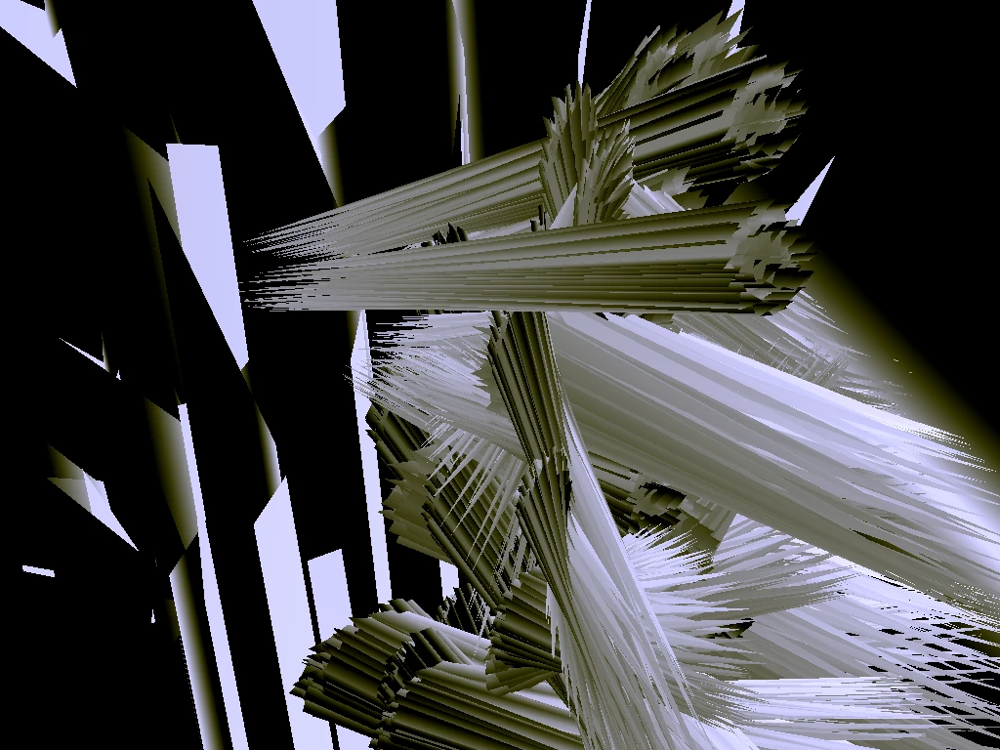
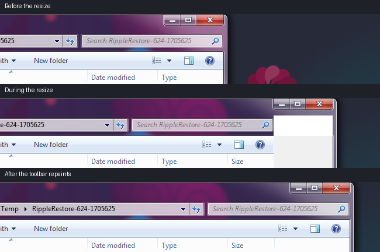

# Mesa on Windows 7

Does Mesa 24.3.4, the release the Mac side uses, build for Windows 7 and run there, before
any driver of ours exists? Yes, with software rendering: Mesa's OpenGL draws in the Windows 7
test VM, and its Direct3D 10 driver (`libgallium_d3d10.dll`) gives a working Direct3D 10
device through Windows 7's own Direct3D runtime. 2026-11-14.

## Build

`windows/mesa/build-win7.sh`, on the Linux build host:

- Source: the release tarball (`mesa-24.3.4.tar.xz`, the same sha256 as the Mac side), unpacked
  into its own tree `.tools/mesa/src-24.3.4-win` and built in `.tools/mesa/build-win7-x64`, so
  nothing of the Mac side's tree or builds is touched. Patches in `windows/mesa/patches/`.
- Toolchain: llvm-mingw 20261104 (clang 23.1.5), the variant that links against `msvcrt.dll`,
  since Windows 7 has no Universal C runtime unless an update adds it. Downloaded into
  `.tools/llvm-mingw` from
  `https://github.com/mstorsjo/llvm-mingw/releases/download/20261104/llvm-mingw-20261104-msvcrt-ubuntu-22.04-x86_64.tar.xz`
  (83 MB, sha256 `6e3342e2e0dfa56e9178f3c34b198f278bd5e603db4a759455d1439cc2230630`).
- Options: `-Dplatforms=windows -Dmin-windows-version=7 -Dgallium-drivers=softpipe
  -Dgallium-d3d10umd=true -Dopengl=true`, LLVM off, no Vulkan, no GLES or EGL.
  `min-windows-version=7` makes Mesa use its own futex replacement instead of
  `WaitOnAddress` (Windows 8). Mesa's `meson.build` still defines `_WIN32_WINNT=0x0A00`; that
  only unlocks declarations, and the DLLs import nothing newer than Windows 7 (below).
- Direct3D 10 headers: Mesa's `d3d10umd` wants the WDK's DDI headers in `include/winddk`
  (its `README.txt` lists them). The build copies them from WDK 7.1 (`d3d10umddi.h`,
  `d3dumddi.h`, `d3dkmthk.h`, `d3dkmddi.h`, `d3dkmdt.h`, `d3dukmdt.h`, `dxgiddi.h`,
  `dxgiformat.h`, `dxgitype.h`, `dxmini.h`, `wmidata.h` and the two tokenized program format
  headers) into the build's own tree; they are never committed.

What had to change:

| Where | Change | Why |
|---|---|---|
| Compiler flags | `-Wno-error=incompatible-pointer-types` | clang 23 makes it an error; Mesa's SPIR-V code passes a `jmp_buf` to MinGW's `__builtin_setjmp` |
| Local copy of `d3d10umddi.h` | `MAKE_##TYPE##(` becomes `MAKE_##TYPE(` | only MSVC accepts the second paste |
| Local copy of `d3d10umddi.h` | its global `const UINT`/`const INT` constants made `static` | in C files they are duplicate symbols; with MSVC Mesa hides them by including `d3d10_1.h` first |
| `patches/0011-x86-aligned-matrix-stack.patch` | the GL matrix stacks allocated 16-byte aligned | 32-bit only: `msvcrt.dll` aligns `calloc` to 8 bytes (below) |
| `patches/0010-win7-wdk71-d3dkmt-and-gdi.patch` | `D3DKMTPresent` takes a const pointer; `KMTQAITYPE_XBOX`, `KMTQAITYPE_PHYSICALADAPTER*` and `D3DKMTSetVidPnSourceOwner1` left out at the Windows 7 interface version; two helpers in `d3d10_gdi.c` made `static` | WDK 7.1's headers are older than the ones Mesa is written against |

Result, in `.tools/mesa/out-win7-x64`: `opengl32.dll` (199,680 bytes), `libgallium_wgl.dll`
(16 MB), `libglapi.dll`, `libgallium_d3d10.dll` (8.7 MB). Their imports are only
`KERNEL32`, `USER32`, `GDI32` and `msvcrt`, plus each other; C++ is linked in statically.

## In the Windows 7 test VM

VM 220 (Windows 7 SP1 x64, the Standard VGA adapter, [test-vms.md](test-vms.md)), with two
small test programs built by llvm-mingw (`tools/win7-hello/gltest.c` and `d3d10test.c`):

| Test | Result |
|---|---|
| `gltest.exe` with Windows' own `opengl32.dll` | Microsoft, GDI Generic, OpenGL 1.1.0; the triangle is red |
| `gltest.exe` with Mesa's `opengl32.dll` next to it | Mesa, softpipe, OpenGL 3.3 (Compatibility Profile) Mesa 24.3.4; the triangle is red (255 0 0 read back) |
| `d3d10test.exe`: `D3D10CreateDevice(D3D10_DRIVER_TYPE_SOFTWARE)` on `libgallium_d3d10.dll` | device created; the render target cleared to green, a triangle drawn with a vertex and a pixel shader, copied to a staging texture and mapped: 255 0 0 255 inside the triangle, 0 255 0 255 outside |

The shaders are `tools/win7-hello/tri.hlsl` (vertices made from `SV_VertexID`, no vertex
buffer), compiled to DXBC for `vs_4_0` and `ps_4_0` by `hlsl2dxbc.c` with `D3DCompile` from
Wine 10's `d3dcompiler_47.dll` (which uses vkd3d-shader) on the build host, and embedded in the
test as `tri_vs.h` and `tri_ps.h`. Windows 7's runtime accepted the blobs.

So Mesa's Direct3D 10 user-mode driver loads under Windows 7's Direct3D 10 runtime, creates a
device, and its resource, clear, shader, draw, copy and map paths work. Not covered yet:
Direct3D 10.1 and its 9.x feature levels (what the desktop compositor uses), and the DXGI
present path.

## 32-bit

`ARCH=x86 windows/mesa/build-win7.sh` builds the same four DLLs for 32-bit Windows
(`.tools/mesa/build-win7-x86`, `out-win7-x86`); again only `KERNEL32`, `USER32`, `GDI32` and
`msvcrt` imports, and `OpenAdapter10` exported undecorated. Tested in VM 220 as 32-bit
programs (WOW64 on Windows 7 x64; there is no 32-bit Windows 7 VM):

- Direct3D 10: the same results as on x64, shader draw included.
- OpenGL first crashed in `libgallium_wgl.dll` (access violation in `_math_matrix_ctr`, an
  aligned SSE store): the GL matrix stacks come from `calloc`/`realloc`, which `msvcrt.dll`
  aligns to 8 bytes on 32-bit Windows, while `GLmatrix` is `alignas(16)`. Patch
  `0011-x86-aligned-matrix-stack.patch` allocates them with Mesa's `align_calloc`/
  `align_realloc`/`align_free`; with it the GL test draws (softpipe, OpenGL 3.3, the triangle
  red). Other `alignas(16)` structures on the plain heap could show the same on 32-bit.

## The Yttrium fork (Mesa 26.1) on Windows 7

Tried once (2026-11-14) to see whether a newer Mesa would do: `virtio-win-mesa` at 76c095b,
the same options, without Yttrium's own driver. It does not build against WDK 7.1's headers.
Core Mesa compiles; what breaks: a new shared helper (`src/gallium/auxiliary/gdikmt`, part of
`libgallium` on Windows, so OpenGL too) includes `d3dkmthk.h` without the DDK include path,
WDK 7.1's `d3dkmthk.h` needs SAL annotations the tree no longer defines, and the Direct3D
10/9 code uses Windows 8 and later DDI types (`D3D11_1_DDI_BLEND_DESC`,
`D3D11_1_DDI_LOGIC_OP_*`, `DXGI_DDI_ARG_PRESENT1`, `BLT1`, `OFFERRESOURCES`,
`RECLAIMRESOURCES`, the multiplane overlay calls). The Windows side therefore stays on Mesa
24.3.4; the fork's Direct3D 9 part (MIT) is to be carried back to it.

## The virgl variant: the Mesa side of virtio-win pull request 943

`VARIANT=virgl windows/mesa/build-win7.sh` builds Mesa's virgl driver for Windows 7 x64 as the
user-mode half of a virtio-gpu display driver: `viogpu_wgl.dll` (OpenGL, through Mesa's own
`opengl32.dll` or as the display driver's OpenGL client driver) and `viogpu_d3d10.dll`
(Direct3D 10 and 10.1). It cannot draw until the kernel driver exists; what is checked so far is
that it builds and loads.

Source (in `windows/mesa/patches-virgl/`, applied only for this variant, in its own source tree
`.tools/mesa/src-24.3.4-win-virgl`): the five commits by Max R on `viogpu_win` of
`gitlab.freedesktop.org/max8rr8/mesa`
(Mesa merge request 24223), on top of upstream 366e7e2ddc7. They apply to 24.3.4 unchanged:

| Patch | What it does | Licence of what it adds |
|---|---|---|
| `0001-viogpu-wgl-WGL-GDI-Framebuffer-improvements` | WGL: framebuffer handling for a GDI-presenting driver | changes to MIT files |
| `0002-viogpu-gdikmt-Introduce-gdikmt` | the build hooks and a new handle type for the kernel bridge, **without the bridge itself** (below) | changes to MIT files |
| `0003-viogpu-d3d10umd-Viogpu-for-windows-improvements` | the Direct3D 10 driver: talks to a kernel driver through the bridge, formats, DXGI present | changes to MIT files |
| `0004-viogpu-virgl-gdi-Introduce-virgl-winsys-for-windows` | virgl's winsys for Windows (`winsys/virgl/gdi`), and the private kernel interface header `src/virtio/wddm/viogpu_wddm_driver.h` | winsys: MIT (Red Hat header); interface header: BSD-3-Clause (Red Hat) |
| `0005-viogpu-targets-Add-virgl-to-wgl-and-d3d10-targets` | virgl in the WGL and Direct3D 10 targets; `dxgi_framebuffer.cpp` | MIT (Microsoft header, from Mesa's d3d12 WGL code) |

Scanned for GPL, LGPL and MPL text: none in any patch. Four files of commit 77e160421bd, the
kernel bridge `gdikmt` (`auxiliary/gdikmt/gdikmt.h`, `gdikmt_d3dkmt.c`,
`frontends/d3d10umd/gdikmt_d3dddi.cpp`, `gdikmt_d3dddi.h`), carry no licence header at all.
Decision (2026-11-14): we write our own bridge; those four files are never committed. Ours is
in `windows/mesa/overlay-virgl/` (MIT, same four file names, written from the description in
"What the rest expects from the kernel bridge" below): the build copies it over the source
tree after the patches, and the source tree's stamp covers it, so a change to it unpacks the
tree again.

Our patches on top: `0010` and `0011` as above, `0012` (the DDK headers on the include path of
the bridge, the virgl winsys and the WGL target: with MinGW, `d3dkmthk.h` comes from
`include/winddk`), `0013` (a pointer-to-handle cast clang rejects on 64-bit), `0014` (the
Windows 7 completion event and which allocations belong to the runtime, below), `0015` (`bool`
for the `boolean` type Mesa has dropped, which the winsys still used: the original bridge header
defined it, ours does not). The build also leaves WDK 7.1's `dxgiformat.h` and `dxgitype.h` out
of `include/winddk`, so the DXGI framebuffer code sees MinGW's newer ones, and has the local
`d3dkmthk.h` include Mesa's `winddk_compat.h` (empty SAL annotations) itself.

Result: `viogpu_wgl.dll` imports only `GDI32`, `KERNEL32`, `USER32`, `msvcrt` and
`libglapi.dll`; `viogpu_d3d10.dll` only `KERNEL32` and `msvcrt`. The bridge loads the D3DKMT
functions from `gdi32.dll` at run time, so nothing Windows 7 lacks is imported. In VM 220 both
load with all imports resolved (`tools/win7-hello/dllload.c`); `OpenAdapter10`,
`OpenAdapter10_2`, `DrvCreateContext`, `DrvSetPixelFormat` and `DrvValidateVersion` are there.

Windows 8 and later assumptions found:

- Command completion: after each submission the bridge asks the kernel to signal a CPU event
  when the GPU is done, through `SignalSynchronizationObject2` with a CPU event (the D3DKMT
  function from `gdi32` on the OpenGL path, the runtime's callback of the same name on the
  Direct3D path). Both are WDDM 1.2 (Windows 8). On Windows 7 (`0014`) the winsys ends the
  command buffer with a command of the kernel driver's private protocol,
  `VIOGPU_CMD_SIGNAL_EVENT`, and the kernel driver sets the event when the buffer has run on the
  host; with no room left for that command, the event is set at submission.
- Nothing else: the Direct3D driver reports the Direct3D 10.0, 10.0.x, 10.0.7 and 10.1 DDI
  versions only, which Windows 7's runtime has.

The private protocol between these DLLs and the kernel driver (escape packets for resource
info and busy state, and the per-allocation data exchanged at allocation creation and open) is
in `viogpu_wddm_driver.h` and must match the kernel driver (`windows/kmd`).

### What the rest expects from the kernel bridge

Described from how the other patches use it, for writing our own (names as the callers use
them; nothing taken over from the four files):

- A device object standing for one adapter and device in the kernel driver, with a table of
  operations, and two ways to make one: from a window's device context (`gdikmt_create_from_hdc`,
  used by the WGL target: open the adapter behind the HDC and create a device on it with the
  D3DKMT functions), and from the Direct3D runtime (`gdikmt_d3dddi_fill_basefuncs`, used when
  the Direct3D driver creates its device: the same operations, carried out through the runtime's
  device callbacks and handle; the Direct3D device keeps this bridge device in its own state as
  `gdikmt_device_d3dddi`).
- Device operations the virgl winsys calls: query adapter information (driver-private data),
  escape (driver-private packets), create allocations for a resource (in: count, per-allocation
  info, resource-level private data; out: resource handle), destroy them, open shared
  allocations from a global handle (in: handle, count, per-allocation open info, private data;
  plus a buffer for all private data), query a shared allocation, lock an allocation for CPU
  access, create a context, present, destroy; the Direct3D side also uses flush, and set display
  mode for DXGI's present.
- A context object holding the current command buffer, allocation list and patch-location list
  with their sizes, with a submit operation (`gdikmt_render`): command offset and length, the
  number of allocations and patch locations used, the sizes wanted for the next buffers with
  flags to grow each, and an optional event to signal on completion. After a submit the context
  points at the buffers the kernel hands back.
- Helper entry points with the same shape as the operations: `gdikmt_createallocation`,
  `gdikmt_openallocation`, `gdikmt_render`.

## The Direct3D 9 part (2026-11-15)

Windows 7 programs that use Direct3D 9, and Windows' own assessment tool, need a Direct3D 9
user-mode driver. Ours is the one of the Yttrium project's Mesa fork (its `virtio-win-mesa`
at commit 76c095b, Mesa 26.1.0; `docs/windows/yttrium-notes.md`): the ten files
`src/gallium/frontends/d3d10umd/D3D9*`, all MIT, by Ake Rehnman, with the shader translator
taken from Mesa's "nine" (MIT, Joakim Sindholt and Christoph Bumiller). They are in
`windows/mesa/overlay-virgl/` with their notices, and are built into the same DLL as the
Direct3D 10 driver, which then also exports `OpenAdapter` (patch 0019).

What was changed to bring them from that tree to Mesa 24.3.4 on virgl:

- **The renderer underneath.** The files call that project's own renderer in a dozen places
  and include two of its headers (MPL-2.0, not used here). `D3D9Host.h` and `D3D9Host.cpp`
  (ours) answer the same calls for virgl: a flush is a flush, the rest has nothing to answer.
  The multisample counts and the anisotropy limit came from that renderer. The anisotropy
  limit is fixed at 16 samples (Windows 7's Direct3D 9 wants that many for a hardware
  device, `docs/windows/kmd-port-notes.md`); the sample counts are asked of the host since
  2026-11-19 ("Multisampling", below).
- **Mesa 26.1 to 24.3.** Capability lookups by function instead of the screen's tables;
  one more argument to `set_sampler_views`, `set_constant_buffer` and `ureg_tex_insn`;
  framebuffer and clear surfaces created as objects instead of held by value; three small
  helpers that 24.3 lacks (`D3D9Compat.h`, ours).
- **The kernel bridge** (`gdikmt_d3dddi`, ours) learned what a Direct3D 9 device needs:
  presents go through the device's own present callback with the destination the runtime
  names, and an opened resource is described in Direct3D 9's structure.
- **The kernel driver's allocation data** has no blob memory flag and no stride on Windows 7;
  the two places that read them use what the format says.

Two faults showed in the host's log at the first test, both for resources Gallium allows and
virglrenderer 0.10 refuses, and both are put right in the virgl driver (patch 0020): a texture
without any binding (the Direct3D 9 code reads pictures back through such textures), and a
sample count of one for "not multisampled" (the same thing patch 0016 met in the Direct3D 10
driver).

**First test** (`tools/win7-hello/d3d9test.c`, test VM, Aero on): a hardware device with
vertex processing in the driver is created in a window, the back buffer cleared to green, a
red triangle drawn from screen-space vertices, the picture read back (right in both colours)
and presented: the window shows it. Nothing in the host's log.

Not looked at yet: everything beyond that test. The fork's notes say what to expect
(`docs/windows/yttrium-notes.md`): fixed-function drawing leans on the Direct3D 9 runtime
turning it into shaders, user clip planes are not switched on, and every draw creates and
destroys its state objects, which on virgl is a command to the host each.

### What Windows' own assessments found (2026-11-15)

Windows' assessment tool (`winsat`, the Windows Experience Index) was the first real user of
the Direct3D 9 part, and of more of the Direct3D 10 part than the compositor needs. Each of
these stopped it; in the order met, with how it was found:

| Seen | Cause | Where it was put right |
|---|---|---|
| The tool crashed inside Direct3D 9 when it freed a resource | Every allocation was tied to the runtime's resource; virgl's winsys frees some later, when that resource is gone | Only primaries and shared resources are tied (`D3D9Resource.cpp`, `D3D9Host.cpp`) |
| It crashed in our winsys during a draw (call chain read from a crash dump, `tools/win7-debug/dumpstack.py`) | Mesa 24.3 takes over a reference to each bound vertex buffer, 26.1 takes none | One reference added per buffer (`D3D9Draw.cpp`) |
| Texture tests ended at once | Three 16-bit formats listed and not creatable | Mapped (`D3D9Resource.cpp`) |
| Every Direct3D 10 test: "out of memory" | Direct3D's 24-bit depth with stencil exists on the host only in the other order | The screen is asked which order it has (patch 0022) |
| A Direct3D 10 test drew nothing and "ran" at 12 000 frames a second | Indexable temporaries of a shader not declared as arrays; the host could not compile it and dropped the context | Declared as arrays (patch 0024) |
| The same, for any program that cleared its device state | An end of a render condition that was never begun is an error on the host | Not sent (patch 0023) |
| Video playback never started | The driver listed two video formats it cannot make, and answered "not implemented" to "how many video processors" | Formats not listed; the counts answered with none, so Windows uses its own software processor (`D3D9Adapter.cpp`) |
| Blue screen when playback did start | The kernel driver's scan-line call was a debugging trap | A scan line worked out from the vertical-blank thread (`windows/kmd`, `GetScanLine`) |

The last three kinds have one thing in common worth remembering: **the host renderer answers
some mistakes by silently dropping everything a context draws afterwards**, and the guest
sees no error. Its log (the VM host's journal) is the place to look first when a program runs
and shows nothing, or runs absurdly fast.

Tools that came out of it: the driver's own log (`RIPPLE_UMD_LOG=FILE` in the program's
environment), a trace of every Direct3D 9 call into the driver with its result
(`RIPPLE_UMD_TRACE=1` for failed calls, `2` for all), `dumpstack.py` for crash dumps and
for dumps of a waiting program (`tools/win7-hello/dumpproc.c` writes those).

### The Windows Experience Index (load test 16, 2026-11-15)

A fresh test VM, the package as the repository builds it (kernel driver, one user-mode DLL
with the Direct3D 9 and Direct3D 10 parts), one reboot, then `winsat formal`: it runs to the
end and Windows shows scores. Before this driver the index could not be computed on the test
VM at all. Stock virglrenderer 0.10.4 on the host, nothing in its log during the run. (The
comparison is the assessment the disk kept from 2025, on a passed-through Radeon of the HD 5800
series; it was first written down here as the GeForce 9600 GT's.)

| | Ours | Radeon HD 5800 series, same disk (2025) |
|---|---|---|
| Graphics (desktop, Aero) | 4.6 | 7.8 |
| Gaming graphics | 5.6 | 7.8 |
| Processor, memory, disk | 7.7, 7.9, 7.9 | 7.7, 7.9, 7.9 |
| Video memory throughput | 4 138 MB/s | 57 925 MB/s |

The assessment's own frame rates, 1280x1024: Direct3D 9 Batch 81, Alpha 80, ALU 55, Texture
load 52; Direct3D 10 Batch 96, Alpha 95, ALU 60, Texture load 47, Geometry 88 and 29,
Constant buffer 45; video playback 143 frames with a decode time of 0.66 s. Nothing has been
done for speed yet: the Direct3D 9 part still creates and destroys its state objects for
every draw, and both parts seem to stop near 80 to 96 frames a second whatever is drawn,
which points at a wait per frame. That is for the performance pass.

The wait was the kernel driver's: one command buffer at a time, each part waited for. With
several buffers in flight (load test 23, `docs/windows/kmd-port-notes.md`, "Command buffers
in flight") the scores are 6.1 for graphics and 6.1 for gaming graphics, and the frame rates
Direct3D 9 Batch 482, Alpha 502, ALU 280, Texture load 258; Direct3D 10 Batch 140, Alpha
129, ALU 89, Texture load 85, Geometry 135 and 30, Constant buffer 84.

### DirectDraw, DirectX 7 and 32-bit programs (2026-11-15)

DirectX's own diagnostics (`dxdiag`) said "Direct3D: Not Available" while Direct3D 9 and 10
both ran. Three things were behind it:

1. **dxdiag is a 32-bit program, and so are most programs and games for Windows 7.** A 32-bit
   program needs a 32-bit build of the user-mode driver, in `SysWOW64`, named in the driver
   key as `UserModeDriverNameWow`. The package had none. `ARCH=x86 windows/mesa/build-win7.sh`
   builds it; the INF now installs it and names it.
2. **The 32-bit driver knew nothing of the host.** The request for the host's capability set
   carries a pointer, so its packet was four bytes shorter in a 32-bit program and the 64-bit
   kernel driver refused it. With no capabilities every primitive counted as unsupported, and
   the first draw converted primitives in circles until the stack was full. The field is
   eight bytes in every build now (patch 0026 and `windows/kmd/shared/viogpum.h`).
3. **DirectDraw asks the Direct3D 9 driver older questions** (it opens the driver with
   interface version 7 and asks for the DirectX 3 and DirectX 7 capability blocks). The
   driver left the DirectX 7 one unanswered, and DirectDraw then runs on software without a
   word. The answer, and the DirectX 7-era drawing that programs then expect, come from
   vmlab-win3d (<https://github.com/VMLabDev/vmlab-win3d>, MIT, commit b7e5451): its patches
   0006 (the Direct3D 9 files' part), 0012, 0013, 0014, 0024, 0035 and 0040 to 0044, merged
   into our copies of the Direct3D 9 files and adapted to Mesa 24.3 the same way as the files
   themselves. They bring: the DirectX 7 and 8 capability blocks, write-only locks that keep
   the surface's contents, DirectDraw surfaces that can be presented, a vertex shader for
   pre-transformed vertices, colour-key and mirror blits on the GPU, fixed-function fog and
   points, bump and luminance formats.

After these, in the test VM: 32-bit DirectDraw reports hardware capabilities and lists the
"Direct3D HAL" and "Direct3D T&L HAL" devices of DirectX 7 (`tools/win7-hello/ddprobe.c`);
the 32-bit build of `d3d9test` draws and reads back right; dxdiag shows DDI version 10 with
DirectDraw, Direct3D and AGP texture acceleration enabled and "No problems found"; the Windows
Experience Index still runs to the end (5.1 on this run).

Not tried yet: an actual DirectX 7 or 8 program. Nothing here has drawn through those paths.

### Windows 7's own games (load test 18, 2026-11-15)

On a fresh install of the package (64-bit and 32-bit driver), with the host's log watched:

| Program | Result |
|---|---|
| Chess Titans (Direct3D 9) | Board, pieces, reflections and the camera animation right; moves made and answered |
| Mahjong Titans | Layout screen right, hover highlights |
| Purble Place, including the 3D cake factory | Right |
| DirectX's diagnostics (`dxdiag`, a 32-bit program) | "No problems found"; DirectDraw, Direct3D and AGP texture acceleration enabled; DDI version 10 |
| `ddprobe` (32-bit DirectDraw and DirectX 7) | Hardware capabilities; "Direct3D HAL" and "Direct3D T&L HAL" listed |
| `d3d9test`, 64-bit and 32-bit | Right |
| Windows Experience Index | Runs to the end (4.6 to 5.1 between runs; gaming graphics 5.6) |

Chess Titans first made the host log "Multisample textures not 2D" hundreds of times: it
refills vertex buffers with locks that discard their contents, and the virgl driver made the
new buffer with the sample count of one that patch 0020 had only corrected for a first
creation. Patch 0020 now covers both.

Also seen: after ten idle minutes Windows switched the display off (the kernel driver gets the
monitor's power state), and the first mouse movement brought it back with the compositor
running. Sleep and hibernation stay switched off by the INF.

### Windows Media Player: the picture stays black (2026-11-15; solved 2026-11-19, see "Video playback")

The sample video plays (sound, time, controls) but its picture is black. The assessment's
video test, which counts decoded frames, never showed this. What the Direct3D 9 trace found
(`RIPPLE_UMD_TRACE=3`, which also writes the arguments of resource creation, locks, blits,
fills and presents and the middle pixel of surfaces; `tools/win7-debug/guest/wmp.cmd`):

- The video renderer asks for Direct3D 9's progressive video processor by name, even though
  the driver lists none, for RGB video (1280x720, X8R8G8B8), and gets "not implemented". It
  then scales frames on the processor into system-memory surfaces and blits those: they hold
  only zeros, because nothing ever writes the decoded frames into them.
- A minimal progressive processor in the driver (RGB in, background fill, scaled copy; kept
  aside as a patch, not in the repository) is taken: every frame goes through
  `VideoProcessBlt` from the decoder's video-memory surfaces. The picture stays black, and it
  stays black even when the processor paints its target magenta.
- So the frames do not reach the screen. Chess Titans presents by blitting its back buffer
  into the compositor's surface for its window (`Blt` with `BeginPresentToDwm` and
  `EndPresentToDwm`). The player's presenter calls `Present` with no destination instead; the
  driver passes that on as a kernel present without a target, the kernel driver never sees a
  present for it, and the compositor shows nothing.

Windows' Direct3D 9 runtime has a path that binds a swap chain to the compositor
(`CSwapChain::BindToDwm`) next to the blit path Chess Titans takes: the compositor then takes
the frames from the shared surfaces itself, and the kernel driver sees no present, which
matches. With the driver's log switched on for every process (machine-wide `RIPPLE_UMD_LOG`,
then a reboot, so that the compositor has it too), the compositor's side logged no refused
resource while the video played.

That path is Direct3D 9Ex's FlipEx swap chain: `BindToDwm` creates the FlipEx semaphore and
binds through `dwmapi` (ordinal 125), and none of the runtime's FlipEx conditions involve the
driver. So with the compositor running (since the driver counts as WDDM 1.1) the player's
presenter uses FlipEx, and the compositor reads the player's shared surfaces itself, through
our Direct3D 10 driver in its own process.

Next: check that path, the compositor opening a surface the Direct3D 9 driver shared, and
what it reads (a picture the compositor shows black reads as zeros, so likely another host
resource than the one the player drew into); then put the processor back and check the
picture.

None of that was the cause; "Video playback" below has what was.

## Shaders that fit the host (2026-11-16)

Two Direct3D 10 tests of the Experience Index went to the host in a form it handled badly. Patch
0030 made that visible: with `RIPPLE_UMD_LOG` set, `RIPPLE_DUMP_TGSI` writes every shader the
driver translates, as TGSI text, to the driver log (release builds have no `ST_DEBUG`).

**The constant buffer test drew nothing on Hog.** Its vertex shader uses all 14 Direct3D 10
constant buffer slots. The driver binds slot n as Gallium's constant buffer n + 1 (patch 0003),
so it needs buffer 14. virglrenderer reports `GL_MAX_VERTEX_UNIFORM_BLOCKS + 1 - 1` as the
limit: one more for the ordinary uniforms (buffer 0), one less for a block of its own
(`VirglBlock`, which every last vertex stage gets for the y flip). On Hog's Direct3D 12 OpenGL
(14 blocks) that is 14 buffers, 0 to 13; the shader then needed 15 blocks, failed to link
("Too many vertex uniform blocks (15/14)"), and virglrenderer dropped the test's draws, which
it counted at 1700 to 2150 frames a second. The rig's Intel driver has 16 blocks and was not
affected. Patch 0032: a slot at or past the screen's `PIPE_SHADER_CAP_MAX_CONST_BUFFERS` is
read as a buffer texture instead, `TXF` from an unsigned view (as the driver's other buffer
loads on virgl; virglrenderer has no `SAMPLE_I`), and before each draw a view of the buffer
bound to that slot is bound at the highest sampler views below 16. On Hog that is slot 13
only. `RIPPLE_CB_LIMIT=N` lowers the limit to try the path anywhere: on the rig, the test with
slot 13 as a buffer texture draws the same scene as with all 14 as uniform blocks (pictures
compared during the run), at 303 against 317 frames a second.

On the way, a fault in Mesa's virgl driver (patch 0029, also in Mesa's main branch):
`virgl_set_sampler_views` gave its encoder the whole binding array, which the encoder writes
from `start_slot`, so views set from any slot but 0 sent the views of slot 0 onwards instead.
Callers that start at 0, as almost all do, never noticed; the single view at slot 15 read
zeros.

**The second geometry test drew the wrong shapes**, which was only noticed as slowness on the rig
(59 frames a second; about 1000 on Hog, and the fastest test on real hardware). Its geometry
shader runs a loop of three steps that writes an indexable temp array (`x0[r0.z * 2]`). The
driver sent that as a TGSI array indexed through an address register, handing out `ADDR[0]`,
`ADDR[1]` and `ADDR[2]` in turn; virglrenderer writes every indexed store through `addr0`
whatever register the shader names (`get_temp` with dimension 0 for destinations, in 0.10.4 and
1.0.0; loads use the named one). Two of the shader's three stores went through `ADDR[2]` and
landed on the wrong elements, so it extruded triangles from wrong vertices: long spikes across
the screen, which cost the rig's Intel GPU most of each frame and the RTX 4090 little. Patch
0031 declares arrays of up to 16 elements as plain registers: a read through an index gathers
the element with compare-and-select before the instruction, a write is scattered to the
elements after it, so no indexed store reaches the host. Same install, back to back on the rig:
68 frames a second with the arrays (`RIPPLE_INDEXED_TEMPS=1`), 704 with the selects, and the
shapes the test means to draw. (Mesa's `tgsi_to_nir` cannot take geometry shaders, no `EMIT`,
`ENDPRIM` or `RET`, so this could not go through NIR.)

The same address-register habit met virglrenderer in more places: it also reads indexed
constants through `addr0` in 0.10.4 (the rig's; 1.0.0 uses the named register), drops the
constant part of a run-time geometry shader vertex index, and ignores run-time indexing of
immediates. Patch 0033 takes run-time indexes one at a time, as Mesa's own TGSI producer does:
each indexed read is a MOV of its own right after the `UARL` that sets `ADDR[0]`, each indexed
write goes to a temporary stored through `ADDR[0]` after the instruction, a geometry shader's
vertex index gets its constant part added in and goes through `ADDR[1]`, and the immediate
constant buffer is read through selects up to 16 entries and through a temporary array copy up
to 64, with zero past its end (as Direct3D reads past a constant buffer).

An independent review of the change (three reviewers, each finding checked by another) found three
more things, fixed in the same patch: a pixel shader's colour output written at a run-time index
always landed in the first output (virglrenderer ignores the index there; each declared output is
now written under a compare); the instructions with two results (`sincos`, `udiv`, `imul`, `umul`)
took the second result's index, and `imul`/`umul` their sources, after the first result was
written; and an index past the immediate constant buffer read its first entry instead of zero.
Still open: an immediate constant buffer of more than 64 entries indexed at run time reads its
first entry (the driver log says so); reading it as a buffer texture, like patch 0032's constant
buffers, would cover it.

That mattered most where nobody had looked: WinSAT's ALU and texture tests build about 4100
shaders each, every one with run-time constant reads (12288 in all, from the driver log). With
the address registers in turn, a shader's second read went through `ADDR[1]`, which the rig read
as `addr0`, so it fetched the first read's element again and the spheres came out dark and flat.
Their speed did not change measurably (285 to 315 frames a second before, 283 to 301 after,
runs alternated, with another VM busy on the same GPU). The Experience Index stays at 7.5 on Hog and
7.1 on the rig.

![The rig, ALU test, every index through ADDR[0]](../../media/win7-alu-rig-addr0.webp)

| Experience Index | Hog before | Hog after | rig before | rig after |
|---|---|---|---|---|
| Graphics / gaming graphics | 7.5 / 7.5 | 7.5 / 7.5 | 6.9 / 6.9 | 7.1 / 7.1 |
| Direct3D 10 geometry F4 / V8 | 1031 / 940 (V8 drawn wrong) | 1077 / 1048 | 639 / 59 (V8 drawn wrong) | 627 / 737 |
| Direct3D 10 constant buffer | 2150 (not drawn) | 688 | 311 | 312 |

Chess Titans and the desktop with Aero look as before on both.

## Direct3D 9: state objects kept from draw to draw (2026-11-17)

`RIPPLE_CMD_STATS` on the Direct3D 9 batch test (31 draws a frame) showed what the Direct3D 9
part of the driver sent for each frame: 217 `CREATE_OBJECT`, 217 `DESTROY_OBJECT`, 248
`BIND_OBJECT` and 62 framebuffer changes, 29 KB a command buffer where the Direct3D 10 test
with the same scene sends 10 KB. `D3D9DrawDiffuse` made everything a draw needs and deleted
it again after the one draw: blend, rasterizer and depth states, the vertex layout, a
sampler state and a view for every texture, a surface for every render target.

Now each description is made once and kept (`D3D9Kept` in `D3D9Draw.cpp`): a store of 32
slots a kind for blend, rasterizer, depth and sampler states and vertex layouts, found by
comparing the description, where the one used longest ago gives way and never one the
current draw has taken; and with each resource the last sampler view and the last surface
made of it, used again while the next one asked for is the same. The command buffer of that
frame is 20 KB with no object made or destroyed in it.

That left the binding: a draw took everything off the context when it was done (state
objects, shaders, textures, an empty framebuffer, the viewport's neighbours set again) and the
next draw put it all back, some twenty commands a draw that changed nothing. Now what a draw
binds stays bound, the next draw sends only what differs (`D3D9Bind`, `D3D9BindSamplers`, the
values in `device->bound`), and `D3D9SettleDrawState` takes it all off before anything else
sets the context's state by hand (the keyed blit) or deletes a shader that may be bound. The
same frame is 10 KB now, as in Direct3D 10: 6 `BIND_OBJECT` instead of 248, one framebuffer
change instead of 62, no shader bound twice. Sent for each draw still: its vertex and index
buffers and its two sets of constants.

Not touched: a draw of already transformed vertices still makes its fixed-function vertex
shader and deletes it afterwards, one shader a draw.

Frames a second, drivers swapped on one boot, two rounds each. First the objects kept, against
the driver before:

| Direct3D 9 test | Hog before | Hog, objects kept | Rig before | Rig, objects kept |
|---|---|---|---|---|
| Batch | 1463, 1490 | 1750, 1624 | 717, 729 | 731, 728 |
| ALU | 1073, 1080 | 1193, 1265 | 281, 281 | 282, 294 |
| Texture load | 964, 974 | 977, 1028 | 308, 307 | 309, 310 |

Then the state left bound as well, against the objects kept (Hog only; the rig is bound by its
GPU and was not measured again):

| Direct3D 9 test | Hog, objects kept | Hog, state left bound |
|---|---|---|
| Batch | 1637, 1638 | 1895, 1899 |
| ALU | 1157, 1182 | 1330, 1306 |
| Texture load, three runs a round | 977, 979, 963 and 954, 964, 1000 | 962, 981, 955 and 1002, 958, 998 |

On Hog, where the path to the GPU is the limit, the batch test gains 9 to 20% from the first
step and 16% more from the second, the ALU test about 13% from each; the texture load test,
with four textures changing on every draw, stays where it was. (Until 2026-11-17 these two
rows carried each other's names; the numbers are as measured.) The drawing test reads its
picture back right in 64 and 32 bits, Chess Titans draws as before (board, pieces,
reflections), no renderer errors.

Where Hog's time goes after the sixth speed round of the kernel driver (the profile of
`docs/windows/kmd-port-notes.md`, repeated): QEMU's drawing thread is 85% busy at 1620 frames a
second in the Direct3D 10 batch test (66% before), 46% of that inside NVIDIA's Direct3D 12
driver and 21% in the kernel, a third of it under the one `glFenceSync` a frame.

Tried and not kept: sending the commands of an ended event query only when the program asks
about it, as Direct3D describes it, instead of at its end. WinSAT still sent one frame a
command buffer, and the version tried answered a late question with the newest command
buffer's fence, so WinSAT waited for the frame it had just sent: 628 and 649 frames a second
against 1655 and 1677.

A trap in the test scripts, found on the way: a guest script that sets `RIPPLE_UMD_TRACE`
left it set in the prompt it was run from, and every Direct3D 9 test started there afterwards
logged each call (the batch test at 95 frames a second instead of 730, Direct3D 10 unharmed).
The scripts that set driver variables now begin with `setlocal`.

## Aero on a host without Direct3D 10: the compositor's Direct3D 9 path (2026-11-17)

On a host renderer below GLSL 1.50 (UTM on Apple silicon: OpenGL ES 3.0 through ANGLE on
Metal, reported as GLSL 1.30) the driver makes no Direct3D 10 device, and the desktop was
Windows Basic. The compositor has a second way: `D3D10CreateDevice1` at feature level 9.3,
which Windows' own layer (`d3d10level9.dll`) runs on the driver's Direct3D 9 part. Six things
were in the way, each found behind the one before. The first two keep the compositor from
trying, the rest spoil what it draws.

**1. The adapter said it had Direct3D 10.** The compositor asks the adapter for the Direct3D
10 interface and, when it gets it, tries Direct3D 10 only: a failed device there and it stays
off ("WDDM is not in use"), with not one question to the Direct3D 9 driver. `OpenAdapter10` and
`OpenAdapter10_2` now fail on a host that cannot carry Direct3D 10 (Mesa patch 0037; the
host's level is asked once a process through a device of our own, because the runtime has
none yet at that point). `RIPPLE_NO_D3D10` makes any host answer the same, which is how the
rest was found on the rig, where the screen can be captured.

**2. Windows' layer refused the Direct3D 9 driver at every feature level** (`E_NOINTERFACE`,
after asking only for capabilities). What it requires is a table in `d3d10level9.dll`
(`MinCapsLevel1` to `3`, checked by `ExceedsCapsBits`): capability bits, minimum values, the
event query, and about thirty formats each with the operations it must support, the sRGB
forms derived from `FORMATOP_SRGBREAD` and `FORMATOP_SRGBWRITE`. `tools/win7-debug/l9req.py`
prints the table from a copy of the DLL. Our capabilities passed all of it but one line:
X8R8G8B8 had `FORMATOP_SRGBWRITE` masked off, and the layer wants B8G8R8X8_SRGB as a render
target. It is on now; where the host cannot draw to that format the surface takes the form
with alpha, and failing that the format as it is (`D3D9SrgbTargetFormat`).

**3. Three small refusals of what the layer sets**: fill mode 0 and anisotropy 0 (both mean
"the default" there) were answered with an error, and a vertex shader whose inputs leave a
gap had no vertex layout.

**4. Window contents as diagonal stripes.** The compositor hands a window's bitmap over as a
system-memory surface that is part of a wider one: 657 pixels wide with a pitch of 2708 bytes,
not 2628. The driver read Windows' memory with the pitch of the width. It takes the pitch
Windows gives now.

**5. Everything half a pixel off.** Direct3D 9 puts pixel centres at whole window
coordinates, OpenGL half a pixel further, and the layer (like most Direct3D 9 programs' 2D)
allows for Direct3D 9's rule. The driver added the half pixel to the viewport's translation,
and the host, which takes whole numbers for a viewport, dropped it: each texel of the desktop
landed between two pixels and was read from the wrong one in two of three rows and columns
(text and thin lines in pieces). The shift is made in the vertex shader instead: translated
shaders add half a pixel in clip space at their end (special constant 11), the shaders made
for positions in window coordinates take it off their input. Measured on the rig, the same
desktop composed on Direct3D 10 and on this path: 0 of 92,800 pixels differ in a strip of the
wallpaper and icons (before: a mean difference of 7 a channel).

**6. Two things OpenGL ES 3.0 does not take**, each of which made the host refuse one draw
and then drop everything the context drew (a black desktop with a blinking text cursor):

- Vertex shader inputs with a gap in their numbers. Without explicit locations the host finds
  inputs by counting (`in_0`, `in_1`); the layer's shaders use v0 and v2. Inputs are numbered
  in the order they are declared now (`nine_vs_input_slot`).
- A base vertex on an indexed draw (`DRAW_VBO` answered with error 22, nothing else said).
  It is folded into where each vertex buffer starts, so the draw has none.

With all six, on UTM: the desktop with glass frames, the taskbar and window shadows, and Chess
Titans in a glass frame, both seen in the guest's own screenshots and on the UTM window; no
renderer errors in UTM's log after the last change. On the rig with `RIPPLE_NO_D3D10`: the
same, and equal to the Direct3D 10 picture as measured above.

Checks with the build that has all of it (64 and 32 bit, built from scratch). Where the host
carries Direct3D 10 the compositor still takes it; the Direct3D 9 drawing and probe tests pass
(Hog in 64 and 32 bit, the rig in 64 bit) and Chess Titans is right on Hog and in UTM (on the
rig it was looked at with the build before the last two changes); the assessment on Hog gives
7.9 on every line. On the rig the desktop composed on the two
paths: of 745,472 pixels above the taskbar 403 differ, 24 of them by more than 8 a channel
(the blinking text cursor), the rest along the glass frame. Direct3D 9 frames a second,
drivers swapped on one boot, the driver before and this one: on Hog batch 1826 and
1833, ALU 1327, 1310 and 1319, 1318, texture load 916, 973 and 960, 935; on the rig
batch 661, 641, 640 and 649, 630, 633 before, 667, 633, 657 after (both below the 730 measured
earlier on that host; not from this change, and not looked into).

A host that refuses a draw says only "failed to dispatch DRAW_VBO". `RIPPLE_UMD_TRACE=3` now
writes each draw as the host gets it (mode, start, count, base vertex, vertex layout), a
refused draw writes the source line of its exit, and `RIPPLE_D3D9_REBIND` makes every draw
bind all its state again, to tell a fault in the kept state from a fault in the drawing.

## Compositor crash while creating textures (2026-11-17)

The UTM desktop could lose Aero after opening windows or menus. Two compositor crashes
produced the same invalid-read stack: `msvcrt!memcpy`, `util_copy_box`,
`u_default_texture_subdata`, `D3D9TextureSubdata`, `D3D9UploadManagedTextureData`,
`D3D9CreateResource`. The driver was copying from the most recently created system-memory
texture into a new video-memory texture merely because their dimensions matched. The old
resource could be a borrowed window bitmap whose pixels were no longer mapped. Creating
another resource does not authorize that read.

The guessed upload during resource creation is removed. `TexBlt` still receives the actual
source and performs explicit uploads, including those requested by the runtime for managed
textures.

`tools/win7-hello/d3d9upload.c` reproduces the bad read using a Direct3D 9Ex texture backed by
application memory. It guards those pixels only while creating an unrelated texture of the
same dimensions, restores access, then checks explicit and managed uploads with two colors
each through rendering and readback. The old driver faults during the unrelated creation;
the fixed driver passes all checks in both 64-bit and 32-bit programs in UTM. Both driver
variants were rebuilt from scratch and installed. The desktop retains glass and shadows;
five desktop context-menu / New submenu cycles pass with the same Explorer process and no
new compositor crash. `tools/win7-hello/shellmenu.c` performs that menu check on an English
Windows 7 desktop without creating files. This fixes the reproduced memory fault; animation
timing is a separate investigation.

## Direct3D 9 textured draws and mipmap selection

`D3DSAMP_MAXMIPLEVEL` sets the most detailed mipmap an application wants
to sample. With the state set to 1, a draw can still select level 2 or
higher as a texture recedes into the distance. The previous driver
restricted the texture view to level 1. The driver now keeps the full
resident mip chain in the view and sets the sampler's minimum LOD.

On an Intel desktop OpenGL 4.6 host, the release driver also left textured
rectangles black. For a draw with position and texture coordinates, the
vertex shader requested a missing color input. The driver supplied it on
vertex buffer binding 16. The host rejected that binding with
`GL_INVALID_VALUE` when creating the vertex layout. The driver now chooses
a free binding in slots 0–15 for its default input, keeping the
application's streams available to the shader.

`d3d9mip.exe` and `d3d9mip32.exe` render a 32×32 target from a texture
with a distinct color at every level. Fixing only the vertex binding let
Intel render the rectangle. On both Intel and UTM that build still returned
level 1 for every pixel in three cases that expected level 2. These covered
point and linear mip filtering and an explicit shader LOD. With both fixes,
all thirteen cases passed on both hosts in both process sizes, including a
draw using application streams 0 and 15. Pass the expected full path to
`viogpu_d3d10.dll` to verify which copy of the driver rendered the test.

## Direct3D 9 visibility queries

Games can skip a draw when an occlusion query reports that all its geometry
was hidden. The old driver returned zero even for a fully visible rectangle.
The driver now asks the GPU which samples passed the depth test. On a virgl
host that advertises desktop GL sample counting, it returns the sample count.
On UTM's OpenGL ES backend there is no count to be had: OpenGL ES can only say
whether any sample passed. The host's renderer answers "something" with a
stand-in count, 1024, so that a program which culls below a threshold does not
take the object for a single pixel and drop it, and the driver passes that on
(until 2026-11-19 it reported 1). Hidden geometry is 0. Applications that use
the count as a measure of screen coverage still lack that information on UTM;
exact counts there would need a counting query in the host's OpenGL layer.

| Windows 7 guest, 16×16 rectangle | Hidden | Half visible | Fully visible |
| --- | ---: | ---: | ---: |
| Previous driver | 0 | 0 | 0 |
| UTM, OpenGL ES | 0 | 1024 | 1024 |
| Desktop OpenGL over Mesa D3D12 | 0 | 128 | 256 |

Two queries can cover some of the same draws. The driver splits the GPU
counter at their boundaries and combines the intervals belonging to each
query. Both 32-bit and 64-bit tests checked overlapping queries, reissue,
and releasing an active query. Pixel readback independently verified which
parts of the test scene were visible.

Windows 7 refused to create a hardware device at feature level 9_3 on UTM
when the driver removed occlusion queries from its capability list. Keeping
the capability and rejecting query creation later caused Direct3D 11 to
report device removal. With the visibility fallback, the same feature-level
9_3 path drew a 16×16 square and completed its queries on both hosts.

Run the probes built by `sh tools/win7-hello/build-ui-probes.sh` with the
same arguments in both process sizes. Use `--expect-supported` for exact
counts or `--expect-visibility` for the UTM fallback (nothing is 0, something is
any other count). `tools/win7-debug/guest/querychk.cmd exact|visibility` runs
all four. `d3d9query.exe`
checks depth and overlapping queries. `d3d11query.exe --force-level9`
exercises Windows' Direct3D 10 Level 9 translation. Both accept an optional
expected absolute UMD path for testing application-local builds.

## Direct3D 9 shader constants

Windows games often draw several objects with the same shader constants.
The driver now compares the final packed bytes separately for the vertex
and pixel shaders. If the bytes match the current binding, the driver can
skip sending that stage's constants to the host. Comparing after packing
also accounts for constants supplied by the shader itself. The next draw
rebinds the constants after a state reset or a reported backend draw failure.

On UTM, a Chess Titans session issued 14,280 draws. The driver skipped
12,648 of the 28,560 constant commands the previous draw path would have
sent. Most of the savings came from the pixel shader, whose constants
matched on 12,444 draws. Including command headers, this saved 954,720 of
4,455,360 bytes (21.4%) of inline constant traffic in those draws. A
105,140-draw session on an x86 host showed the same saving per draw.

`d3d9const.exe` and `d3d9const32.exe` draw sixteen color tiles in one
scene and check pixels after all draws have been submitted. They cover
changes to one shader stage at a time, shader-local overrides, empty
bindings and restoring the original values. Both process sizes passed on
UTM and on an x86 host with desktop OpenGL, using both the previous and
candidate DLLs. Pass the expected absolute DLL path to check which driver
rendered the test.

## Aero window movement in UTM

With the texture and guest-clock fixes installed, the compositor still spent most
of its time rendering. A DWM-Core trace recorded seven completed frames in 9.19 s,
including 9.04 s in rendering tasks. The slow driver calls were repeated
`NOOVERWRITE` locks of a 640,032-byte dynamic, write-only vertex buffer. DWM
requested access to the entire buffer to append small pieces of window geometry.

The D3D9 driver now uses Windows write-watch memory for private vertex buffers
whose first lock requests the entire buffer for streaming. On unlock, it uploads
the range spanning the modified pages to the original GPU buffer. This preserves
neighboring vertices and lets Gallium order the upload after earlier draws. A GPU
copy into the buffer ends the optimization. An incomplete page list triggers a
full upload.

`tools/win7-hello/build-ui-probes.sh` builds `d3d9stream.exe` and
`d3d9stream32.exe`. Each renders and checks four tiles across full and ranged
locks, including a discard after queued draws and an indexed draw with a base
vertex and stream offset.

On Windows 7 x64 at 1280×1024 in UTM on Apple silicon, the previous driver
and the new build ran the same 12-second workloads on the same boot. The rates
count SPICE display draw notifications on the host between workload markers,
excluding one second at each end. Aero stayed active in every guest sample.

| Workload | Previous updates/s | New updates/s | Median gap before → after |
| --- | ---: | ---: | ---: |
| Move a window | 2.1 | 17.0 | 468 → 61 ms |
| Minimize/restore every 750 ms | 1.0 | 3.4 | 1,059 → 313 ms |
| Repaint a window | 15.4 | 20.4 | 32 → 32 ms |

The minimize/restore average includes the pause between transitions. Repaint
varied substantially between baseline runs. Window movement showed the clearest
gain. The 95th-percentile gap fell from 841 to 100 ms.

## Aero minimize and restore in UTM

Tracing individual transitions on the vertex-buffer fix found another streaming
buffer in the compositor. During the sampled transitions, 161 whole-buffer
`NOOVERWRITE` locks on a 120,006-byte dynamic index buffer took 4.35 s in total
(median 28 ms per lock). The driver now tracks writes to eligible private index
buffers the same way it tracks writes to vertices.

The table gives medians from a same-boot driver swap on the 1280×1024 UTM
desktop. Each driver ran a 12-second warm-up, followed by seven minimizes and
six restores. Times start at the probe's `ShowWindow` call. Guest timestamps
come from DWM-Core ETW. Host updates are SPICE draw notifications. Clock
alignment adds roughly 10 ms of uncertainty to host timings.

| Measurement | Minimize, previous → new | Restore, previous → new |
| --- | ---: | ---: |
| First completed guest present | 403 → 93 ms | 398 → 87 ms |
| First host display update | 406 → 121 ms | 431 → 114 ms |
| Host updates within 500 ms | 1 → 10 | 1 → 8 |
| Last substantial host repaint | 1,095 → 437 ms | 940 → 429 ms |

The last row estimates animation completion by pairing guest presents and host
updates in order on transitions with equal counts. It uses the last render
whose dirty region extended at least 32 pixels in both dimensions. Individual
restores still showed gaps of up to 199 ms between substantial repaints,
including the initial wait. A separate same-boot comparison also showed the
first guest present falling from 390 to 85 ms on minimize and 346 to 85 ms on
restore.

Both 32-bit and 64-bit streaming probes verified four rendered tiles, including
an index write at the far end of the buffer and a discard with earlier draws
queued. Both texture upload probes passed. Explorer kept the same process
through ten desktop **New** submenu checks across the two runs.

## Explorer restores and bitmap uploads

Restoring an 800×540 Explorer window exposed another cost. In a six-restore
driver trace, DWM created a private system-memory texture from a 784×513
window bitmap on every restore. Its 3,200-byte row pitch included 64 bytes
outside the image on each row. Creating that resource took a median of 52 ms.
The following same-size copy into video memory took another 32 ms.

The driver now leaves the pixels of a caller-backed, single-level BGRA or BGRX
system-memory texture in place until it needs its own GPU image. A window
bitmap used only as a copy source goes directly into the destination, with
the original row pitch. The existing dirty flag triggers an upload for a GPU
read of the source. This follows the system-memory upload approach used by
Gallium Nine. [Mesa 24.3.4, NineSurface9_CopyMemToDefault](https://gitlab.freedesktop.org/mesa/mesa/-/blob/mesa-24.3.4/src/gallium/frontends/nine/surface9.c#L630-705)

On the same 1280×1024 UTM boot, the previous release and the new driver each
ran 30 restores after restarting DWM. All 60 rounds kept Aero active. The
probe posted a restore command to Explorer's window. DWM presents and UTM host
draws matched in order over each 1.15-second observation. Substantial repaints
use the 32×32 dirty-region threshold described above.

| UTM host measurement | Previous release | Direct bitmap upload |
| --- | ---: | ---: |
| Median wait for the first substantial repaint | 111 ms | 104 ms |
| Median of each restore's longest subsequent gap | 185 ms | 120 ms |
| 95th percentile of those gaps | 312 ms | 183 ms |
| 95th percentile, counting only gaps that started in the first 500 ms | 254 ms | 183 ms |

The longest subsequent gap with the new driver was 188 ms. One restore still
took 286 ms to show its first substantial repaint. The window-movement check
delivered 27.0 and 28.6 host updates per second respectively over the same
five-second interval. The 32-bit and 64-bit subrectangle tests each compared
2,048 pixels, including untouched borders, with zero mismatches.

## Clicking Explorer's taskbar button in UTM

A 784×502 window bitmap required a 1.5 MiB Mesa transfer buffer. Smaller
uploads could replace it with the 1 MiB default. On the next restore, merely
writing one byte per row into the new mapping took 31–37 ms. Reading a byte
per source row took less than 0.2 ms, and copying the bitmap after touching
the destination took about 1.3 ms.

The Windows virgl build now grows its default transfer-buffer size to the
next power of two when a bitmap needs more room, up to 4 MiB. Small uploads
can then use buffers of the same size as the window uploads. Mesa continues
to track when each buffer is safe to reuse. In a separate six-click trace,
the median CPU copy of the 784×502 bitmap fell from 37.7 ms to 0.9 ms. The
first copy on the new driver took 38.6 ms, and the next five each took less
than 1 ms.

Each column below used 50 clicks on the dedicated Explorer window's taskbar
button on one Windows 7 x64 boot at 1280×1024. Aero and minimize/restore
animations stayed enabled. First movement means a DWM repaint extending at
least 32×32 pixels into the space above the taskbar, excluding button glow.
The host measurement matches that present with a UTM display draw. All 150
rounds matched in order and the three traces reported zero lost events.
Host/guest clock alignment introduces several milliseconds of uncertainty.

| Measurement | Previous drivers | Refresh timing fix | Refresh timing and upload fixes |
| --- | ---: | ---: | ---: |
| Median click to observed unminimized state | 92 ms | 90 ms | 91 ms |
| Median click to first guest motion present | 257 ms | 245 ms | 198 ms |
| Median click to first host motion update | 276 ms | 261 ms | 204 ms |
| 95th percentile click to first host motion update | 310 ms | 296 ms | 278 ms |
| Longest observed click to first host motion update | 402 ms | 314 ms | 302 ms |

The original drivers and the combined fixes both delivered 24.4 host
updates per second in the separate five-second window-movement sample.
The 32-bit and 64-bit upload tests each verified two queued textures, with
zero mismatches. Explorer kept its process through five desktop **New**
submenu checks on the final driver.

With the stable UTM clock, ten taskbar restores and ten minimize commands
produced the following timings at 1280×1024. A motion present covers at
least 32×32 pixels between the folder and its taskbar button. Each Windows
present matched a UTM draw in order in all twenty transitions. The trace
lost no events. Times are rounded to the nearest millisecond.

| Measurement | Minimize | Restore |
| --- | ---: | ---: |
| Median time to first guest motion present | 86 ms | 200 ms |
| Median time to first matching UTM draw | 92 ms | 212 ms |
| Median of each transition's longest gap between motion draws | 140 ms | 50 ms |
| Longest such gap | 217 ms | 63 ms |
| Median time from a guest motion present to its UTM draw | 8 ms | 7 ms |

In another ten rounds, a two-column strip of composed desktop pixels
showed four or five intermediate changes per minimize
and two or three per restore. Desktop readback took about 63 ms between
samples, so this gives a lower bound on observed changes. The table uses
the separate run without readback.

A test process requested a 1 ms Windows timer period for ten rounds and
released it before another ten rounds on the same boot. Median time to
the first host restore draw was 212 ms before the request, 277 ms with it
and 205 ms afterward. The median longest gap between subsequent restore
draws fell to 32 ms with the request, compared with 50 and 49 ms in the
two controls. The finer timer traded smoother subsequent draws for a
longer initial wait.

### Welcome to desktop

Two UTM boots showed long display gaps around logon. The first had a
2.86-second interval between full-screen draws shortly after Explorer
started. On the second, a boot trace of the Windows compositor recorded
a 2.199-second interval between completed presents. The corresponding
UTM draws were 2.201 seconds apart. The four preceding and twelve
following draws matched the guest sequence within 25 ms relative to the
start of that gap. The trace reported zero lost events or buffers.

The compositor spent 2.13 seconds of that interval in its
`SCHEDULE_WFW` wait for work. Four subsequent boots traced when the
user's Default desktop became active. On every boot, the long gap
began after the compositor had already presented several frames.

Times below are relative to the first sample that saw the Default
desktop active. The switch occurred between that sample and the last
inactive sample, up to the interval in the second column earlier.

| Desktop | Switch sampling interval | First present started | First present completed | Later gap between completed presents |
| --- | ---: | ---: | ---: | ---: |
| 1280×1024 | 42 ms | +324 ms | +997 ms | +1.70 to +4.09 s |
| 1024×768 | 47 ms | +209 ms | +461 ms | +1.17 to +4.02 s |
| 1280×1024 restored | 158 ms | +182 ms | +525 ms | +1.36 to +4.05 s |
| 1280×1024 repeat | 45 ms | +230 ms | +568 ms | +1.26 to +3.79 s |

The last two boots included graphics kernel events. The first present
took 343 and 338 ms. On both, a render packet spent 138–140 ms between
queue submission and completion. Two successive system packets then took
83–85 ms apiece. The compositor requested the flip 339 and 336 ms into
the respective presents. On the next present the flip request arrived
within 1 ms. These are guest queue times and include any time waiting
for execution. [Windows 7 queue event layouts](https://github.com/GameTechDev/PresentMon/blob/main/PresentData/ETW/Microsoft_Windows_DxgKrnl_Win7.h)

The shell window existed 1.34–1.67 s before the first active sample.
On the three boots that queried composition, Windows already reported
it enabled before the switch. The compositor startup call returned a
timeout on three boots and succeeded on the third boot in the table.
All four recorded the long first present. Lowering the resolution
shortened that call on one boot, and the later pause persisted.

Within three seconds on either side of the active sample, Dwm-Udwm
recorded no window-animation start, glass fade or transition event in
the selected event set. Later in the same traces it recorded all 12
test minimizes and 12 restores with the expected animation types.
All four traces reported zero lost events and buffers. The appearance
of the Welcome fade itself still needs a visual reference.
[Capture instructions](../../tools/win7-debug/README.md#timing-the-welcome-screen) ·
[Welcome transition issue](https://github.com/mizaimao/moose-ripple/issues/71)

## Live Explorer resize in UTM

On Windows 7 x64 at 1280×1024, six three-second title-bar drags and six
lower-right-corner resizes moved the pointer 216 pixels across and 108 down.
Aero and full-window dragging were enabled. Guest pointer commands, observed
window bounds, DWM presents and UTM display draws were timed separately.

| Measurement on the merged driver | Drag | Resize |
| --- | ---: | ---: |
| Pointer commands per second | 57.1 | 56.0 |
| Observed window bounds changes per second | 56.4 | 5.3 |
| DWM presents per second | 30.3 | 24.8 |
| UTM display draws per second | 30.2 | 24.7 |
| 95th percentile gap between bounds changes | 31 ms | 226 ms |
| 95th percentile gap between host draws | 61 ms | 89 ms |
| Longest gap between host draws | 112 ms | 188 ms |

A plain Win32 window with a solid background changed its bounds 57.8 times
per second on the same resize path. Host draws can repeat the previous
geometry. Raising the refresh thread's scheduling priority left Explorer at
5.3 size changes per second and produced a 203 ms pause on a title-bar drag.
Combining write-watch queries and resets gave 5.0 size changes per second
against 5.1 on the release driver in an eight-round comparison. Both trials
ran on the same boot and the release drivers were restored.

### Where a resize frame goes (2026-11-24)

A window resized every 16 ms (`tools/win7-hello/dwmtiming.c resize`) is drawn about 19 times
a second on Vista and 30 on Windows 7 in UTM, and the kernel driver's 1 ms timer
(`kmd-port-notes.md`, last section) does not change that. The timing report in the
compositor (`RIPPLE_UMD_TIMES`, which now times each way a copy is done and the three steps of
an upload) gives for one Vista resize frame of 49 ms:

| Part of a resize frame on Vista | Time |
| --- | ---: |
| After the old surfaces are destroyed, outside the driver | 21 ms |
| One upload of the window's picture into the new texture | 10.1 ms |
| The 18 other copies (glass blur passes, screen buffer), all on the GPU | 0.09 ms |
| Present | 4.9 ms |
| 32 vertex buffer unlocks | 2.5 ms |

The compositor makes the same 19 copies in every frame of a moving window, in 0.08 ms. The
upload is the one cost inside the driver. Mapping and unmapping the texture take 0.04 ms each
and reading the source pages beforehand 0.07 ms; the 10 ms are the copy of 1.2 MB into the new
texture's own memory. Every size is a new texture, and Windows hands out new memory a page at
a time as it is written, about 30 µs a page under processor emulation. The same upload into a
texture that already exists (a window repainted at one size) takes 0.6 ms.

Tried and not adopted: sending every texture upload through virgl's staging buffers, which
are used over and over, where before only a busy texture went that way. On Vista it does
nothing, because staging is switched off there (patch 0101: Vista needs a fresh lock for
every access). On Windows 7, one boot, old and new user-mode driver in turn: 29.4 and 29.7
resize updates a second, 55.0 and 54.9 for a moving window. What is left of a resize frame is
Windows' own work for the new surfaces, in the resized program and in the compositor.

### White strip beside the search box

A half-second resize exposed the previous search box beside a white strip
101 pixels wide. A slower three-second resize exposed a strip up to 18 pixels
wide. Both cleared when the toolbar repainted. At 1280×1024, ten half-second
resizes with `explorerrestore.exe 10 search` produced a block 86 to 109
pixels wide in every round. The scan across the search edit and the scan on
the glass above it agreed in all ten. Each started and ended at zero.

The same probe ran on Windows 7 Aero with NVIDIA's 9.18.13.4192 driver
on a passed-through GeForce 9600 GT. Both guests used a 1280×1024 desktop
and the same 680×440 Explorer window. All ten half-second resizes on the
GeForce also produced a white block, with peak widths of 13–28 pixels.
The paired captures above show a separate run that recorded a 102-pixel
block on UTM and a 19-pixel block on the GeForce.

Moving the pointer by the full 216 pixels in one step exposed a 208-pixel
block on both. Both window DCs contained gray at the center of the block
while the desktop showed white. The UTM capture saw the block in three
successive samples spanning 92 ms. The GeForce capture saw it in one
sample. Median sampling intervals were 64 ms and 24 ms respectively.
The captures establish the appearance and ordering of the redraws. They
do not give the exact time the block was visible.

In a separate five-round three-second drag without pixel readback, the
GeForce guest recorded 58.2 size changes per second with a 31 ms 95th
percentile gap. On UTM the corresponding results were 5.3 and 226 ms.
Explorer exposes the newly added area on both systems. UTM's slower
resizing gives the toolbar larger steps to catch up with.

Reducing the UTM desktop resolution also left the lag visible. With a
stable guest performance counter and Aero active throughout, the same window
changed size 5.4 times per second at 1280×1024, 5.1 times at 1024×768 and
5.5 times after restoring 1280×1024 (three rounds per setting). The search
edit showed a white block in all five fast resizes at each setting. [UTM timer configuration](test-vms.md#keeping-aero-active-on-cold-boots)

An ETW profile on UTM compared two three-second corner resizes with two
title-bar moves. The table counts samples from Explorer's window thread
whose call stack included `ExplorerFrame.dll`. It excludes the first
200 ms and last 100 ms of each gesture. A stack can include several of
the functions listed.

| Function on the stack | First resize | Second resize | Both title-bar moves |
| --- | ---: | ---: | ---: |
| Samples with an ExplorerFrame stack | 1,470 | 1,443 | 907 |
| `CNavBar::ResizeBorderDW` | 598 | 567 | 0 |
| `CShellBrowser::_PositionViewWindow` | 323 | 309 | 0 |
| `DirectUI::HWNDHost::SyncRect` | 299 | 273 | 0 |
| `CReBar::_ResizeChildren` | 259 | 242 | 0 |
| `CToolbar::TBPaint` | 138 | 147 | 0 |

The navigation bar layout was on the stack in about 40% of resize samples
in both rounds. A separate ten-round probe timed the move of the search
child and sampled the final search-icon position in the window's backing
bitmap. Even without reading the desktop, all ten rounds still had old
pixels at least 105 ms after the child reached its final right edge.
The median lower and upper bounds for the bitmap to settle were 112 and
143 ms. Issuing one immediate repaint request to the search child at its
final position gave overlapping bounds of 110 and 138 ms in ten rounds.

Reading the same patch on both the backing bitmap and the composed
desktop confirmed the stale bitmap in every trial. Desktop readback
widened the sampling intervals. The source-only measurements above bracket
the delay more closely. The driver can receive stale toolbar pixels well
after Explorer has updated the search field's window coordinates.

Explorer's window DC already contained a gray fill in the newly exposed
area while its toolbar still showed the old contents. A diagnostic driver
copied each relevant source bitmap to private memory before uploading it,
then read the affected row back from the GPU. On one resize the incoming
A8R8G8B8 bitmap had a 120-pixel run of `0x00f0f0f0` at its new right edge.
The sampled GPU texels matched all 120 source pixels. The desktop capture
showed a 120-pixel white band. The next growth step gave an 88-pixel run
in both records. Enabling toolbar double buffering, requesting immediate
repaints and making the glass opaque still exposed the strip. Turning off
full-window dragging moved the flash to mouse release, where it reached
216 pixels.

A diagnostic build zeroed the incoming gray run at the top of the test
window. The scan on the glass then read zero throughout one captured resize,
but a 90-pixel white block was still visible inside the search edit. This is
why the regression probe checks the control's top, middle and bottom as well
as the glass. The release driver preserves the application's pixel values.

The visual defect remains open. [Search-box resize issue](https://github.com/mizaimao/moose-ripple/issues/69)

## Vertex buffer appends on a host that waits for the GPU

A profile of UTM's QEMU process during the Explorer drag and resize
(`tools/win7-debug/README.md`, "What the host does meanwhile") showed QEMU's
main thread waiting inside virtio-gpu command processing for 10% of the drag
and 13% of the resize. More than nine tenths of that was one path:
`vrend_decode_copy_transfer3d`, `glMapBufferRange`, and ANGLE's Metal backend
waiting for the GPU to finish (`waitUntilCompleted`) before it lets the CPU
write into a buffer that queued draws still use. QEMU holds its global lock
during that wait, so every guest processor that needs the lock stops as well.
x64 Windows needs it constantly: each change of IRQL writes CR8, and the
emulator takes the lock to set the APIC's task priority. The guest's four
processor threads spent 11% of the drag and 17% of the resize waiting for it.

The copies were ours. The compositor appends a few vertices or indices to a
dynamic buffer per lock, and the driver uploads the pages that changed when
the lock ends. It asked Gallium for an ordered write (`PIPE_MAP_DISCARD_RANGE`).
On a busy buffer Mesa's virgl driver turns that into a copy from a staging
buffer, placed in the command stream and marked synchronized. A desktop
OpenGL driver serves such a map without stopping. ANGLE on Metal waits.

The upload now follows what the lock promised:

- An append (`D3DLOCK_NOOVERWRITE`) is written unsynchronized. The caller
  promised that queued draws do not use what it wrote, and the rest of each
  uploaded page is what the host already has. The host writes it at once.
- A discard (`D3DLOCK_DISCARD`) takes new storage. Draws queued before it keep
  the old storage, and no ordered copy stays in the queue, where it would land
  after later appends to the same page and undo them.
- A lock with neither promise keeps the ordered copy, and so does every upload
  after it until the next discard.

On UTM (M1 Max, 1280×1024, Aero, Meltdown mitigation off as in
`docs/windows/test-vms.md`), the driver before and after the change ran the
four-round gesture workload on one boot in the order A, B, B, A, B:

| Per three-second gesture | Before | After |
| --- | ---: | ---: |
| Distinct window sizes, corner resize | 36.9 | 41.0 |
| Host display draws per second, resize | 25.7 | 29.7 |
| Host display draws per second, title-bar drag | 32.7 | 37.8 |
| Distinct positions, title-bar drag | 163.5 | 162.7 |

A profile with the change shows the main thread waiting with the lock held for
1.5% of both gestures, none of it in the copy path, and the guest's processor
threads waiting for the lock for 3% of the drag and 7% of the resize. The
profile it is compared with is of the earlier driver on another boot.

`d3d9stream.exe` and `d3d9stream32.exe` (appends, ranged locks and a discard
while draws are queued) read back the expected colors, the texture upload
checks pass in both bitnesses, five desktop context menus open, and a capture
from inside the guest during a resize shows the desktop and the glass frame
intact.

On desktop OpenGL the change is neutral. On the Intel host (VM 220, 1024×768,
Windows' default mitigations) the same order A, B, B, A gave 174.4 distinct
sizes per resize before and 171.8 after, inside the spread of single gestures
(162 to 178) and at the display's rate, with 173 to 176 drag positions on both
sides. The stream, upload and menu checks pass there in both bitnesses too.

## Logon in UTM: what the pause is, and the fade that is not shown

Three things had been taken for one "Welcome holds, then jumps to the desktop"
(2026-11-19, UTM on the M1 Max, 1280×1024, Aero, Meltdown mitigation off).

**The seconds after the switch are a finished desktop.** A capture program
started by a task at logon (`logonshots.exe`) read the screen 48 times from
the moment the user's desktop became the input desktop. The first frame, 42 ms
after the switch, already shows wallpaper, icons and taskbar. The next 28
frames are identical; the first change, 4.4 s after the switch, is the
notification icons arriving. A profile of the emulator over the same seconds
of another boot shows the guest's four processors idle for 79% of the samples
and no host thread at work. The 2.4 to 3.8 s without a new frame in the
earlier traces is this: nothing on the screen changes.

**Welcome itself is the emulated processor.** It lasted about 8 s with all four
guest processors busy for 99% of the samples, a fifth of that translating code
for the first time and looking it up. Its ring was redrawn 7 to 20 times a
second.

**The transition is a fade by gamma ramp, and the driver does not show it.**
`gammawatch.exe`, started the same way, polled the display's gamma ramp through
a logon. Windows lowered the top of the ramp from 65280 to 0 in 31 steps over
0.50 s, switched desktops at zero, and raised it again in 0.48 s. Windows
keeps the ramp it is given (`SetDeviceGammaRamp` succeeds and a half-brightness
ramp reads back as set), although the kernel driver reports no gamma support
and refuses a present path that carries a ramp. Nothing in the display path
applies it. On the screen the ring stops for half a second and the desktop then
appears at full brightness, with no fade in either direction.

Showing the fade means applying the ramp where the kernel driver presents; the
next section does that.

`SwitchDesktopWithFade` cannot be tried from an ordinary program: it returns
FALSE at once (`fadeprobe.exe`), while `SwitchDesktop` works. Locking and
unlocking the session shows no pause of this kind either.
[Welcome transition issue](https://github.com/mizaimao/moose-ripple/issues/71)

## Gamma ramps

virtio-gpu has no gamma control, so the kernel driver applies the ramp itself
(`windows/kmd/viogpu3d/viogpu_gamma.cpp`). It reports ramps of 256 sixteen-bit
entries a channel as supported and takes them from the present path
(`DxgkDdiUpdateActiveVidPnPresentPath`, `DxgkDdiCommitVidPn`). While the ramp
is the identity nothing changes. While it is anything else, the screen is a
second image: the surface that would be on screen, drawn through the ramp.

The drawing is the kernel driver's own, in a virgl context it creates for the
purpose: a rectangle over the whole image, and a fragment shader that looks
each colour channel up in a 256-entry table texture. The flip thread draws the
image again whenever the surface was flipped, a piece of it changed or the
ramp changed, sixty times a second at most, and puts the surface itself back
on screen when the ramp returns to the identity. The table carries the top
eight bits of each ramp entry. The pointer is the host's and is not dimmed.

Two things came up on the way:

- The host renderer binds a sampler view to its texture unit only when the
  view in that slot changed, and binds a view that is being set on whichever
  unit was used last. A table view kept from draw to draw lost its unit to the
  screen surface that way, and the table lookups read the screen. Both views
  are made anew for every draw.
- At a desktop switch Windows destroys the surface on screen before it names
  the next one. The flip thread kept the pointer and went on using it, which
  the plain path survived and the draw did not (the host refused it, or it read
  an unrelated allocation's size). The driver now forgets the surface when its
  allocation is destroyed, under a lock the flip thread holds while it uses it,
  and the image drawn last stays on screen until the next surface comes.

On the Intel host (VM 220, 1024×768), frames read from the host's display
every 0.1 s through a logon show Welcome going to black in six frames and the
desktop coming up in five, and a half-brightness ramp set with
`SetDeviceGammaRamp` halves every sampled channel exactly (228 to 114, 126 to
63, black stays black). The buffer, upload and menu checks pass in both
bitnesses, and the Explorer gestures run as before (172 to 178 sizes per
three-second resize).

In UTM (a trial session with the disk's changes discarded) the host accepted
every command, the same checks pass, and the display client logged 27 draws
during the half second of the fade to black. The fade back in is mostly not
seen there: the compositor's first desktop frame arrives about 0.65 s after
the switch, when the ramp is nearly at the identity again, so the screen stays
black for that time and the desktop then appears almost at full brightness.
That first frame's delay is Windows' own work under emulation (see above).

So the driver does not depend on it. Ramps that arrive while there is no surface
to draw (between the destroyed one and the next) are kept in order, with the
time each came, and applied once a surface is there again, as far apart as
they came. In UTM the display client then logged the fade to black (26 draws in
0.5 s), 0.7 s of black, and the fade in (15 draws over 0.5 s). On the Intel
host, where the first frame comes at once, frames taken every 0.1 s show six
steps down and seven up as before, and the checks pass on both.
What the screen itself shows in UTM has not been captured.

## Video playback (2026-11-19)

Until now Windows Media Player showed a black picture, and Windows' own assessment could not
start its H.264 and MPEG-2 playback tests ("Could not find a codec to decode this file"), on
every host. Four things were missing. Two small programs check them and stay as regression
tests: `tools/win7-hello/d3d9flipex.c` (one colour per step, then the screen is read) and
`vidplay.c` (plays a file through DirectShow or Media Foundation and counts lit points).

**Writes under an ordinary lock were lost.** A Direct3D 9 lock of a video-memory surface that
neither discards nor is read-only maps a staging copy of the surface for reading and writing.
On a host that copies textures into staging buffers (virglrenderer 0.10 and later) Mesa's
virgl driver took such a map for a read alone: the texels were fetched, the program changed
them, and unmap dropped the changes without an error. A surface filled that way and copied
to the screen showed what the host's texture had held before. Patch 0040 makes a map that
writes always write back. This is the step "blit" of `d3d9flipex`; it failed in every run
before the patch.

**A video processor.** Windows' video renderer (the Enhanced Video Renderer) hands every
decoded frame to a DirectX Video Acceleration processor: a frame, a target, two rectangles
and a background colour. With none in the driver it uses a software processor of its own.
The driver now offers the progressive device (`D3D9VideoProcessBlt`): the frame's part is
scaled to its place on the target by the host, and what the frame leaves free takes the
background colour. No colour controls, no sub-streams (Windows mixes subtitles itself
then).

**Plain surfaces are kept in memory.** The renderer keeps each frame in a plain video-memory
surface, which the decoder locks once per frame without discarding. As a host texture that
meant fetching the old contents back from the host for every frame. A plain surface of a
Direct3D 9 program (no render target, no texture) now lives in the driver's memory
(`D3D9IsPlainInMemory`): locks cost nothing, colour fills and copies between such surfaces
are done in memory, and a frame costs one upload into a texture the processor keeps.
DirectDraw's plain surfaces are not included, as it presents from them.

**Two video formats.** With only RGB accepted, a decoder that cannot produce RGB (H.264,
MPEG-2) had nothing to connect to, which is the "codec" message. And Media Foundation's
pipeline, which Media Player uses, ran with RGB but never wrote a frame: the surfaces were
locked twice per frame and their memory stayed empty, as did guard areas put before and
after it for one experiment. DirectShow's pipeline wrote its frames into the same surfaces.
NV12 and YUY2 are now listed as plain-surface formats and taken by the processor; the
decoders then deliver NV12 and the frames arrive.

**The conversion is the host's.** An NV12 frame goes up as its two planes, a one-channel
texture of luma and a two-channel texture of chroma at half the size, and one draw converts
it into a texture the processor keeps (`D3D9VideoDrawNv12`); the scaled blit to the target is
the same as for an RGB frame. That is a byte and a half per pixel to upload and nothing to
compute in the guest. The matrix and range are the frame's own (BT.709 for high definition
and BT.601 below when it names none, studio range). A first version converted in the driver
by table: under emulation that was slower than the decoder's own conversion had been (the
assessment's playback test went from 36.7 to 50.2 ms a frame), so it stays only as the
fallback for YUY2 and for a host without the two texture formats; `RIPPLE_VIDEO_CPU` forces
it, to compare. Both give the same pixels in `d3d9flipex`'s "nv12" and "yuy2" steps
(c8611f for a frame of c86020, 30a0d7 for one of 30a0d8).

**Interlaced video is shown a field at a time (2026-11-19).** An interlaced frame holds two
fields taken a sixtieth of a second apart, on alternate rows; shown whole, anything that
moves is combed. The driver offers a second processor for it, DirectX Video Acceleration's
"bob" device, listed first. The renderer creates it for interlaced video and asks for two
outputs per frame, at the frame's start and half a frame later; each gets one field,
stretched to the frame's height (`D3D9VideoField`). On the host path only the rows of that
field go up, every second row of each plane, and the conversion draw places each at the
height it has in the frame; the in-driver path repeats each row of the field.
`RIPPLE_VIDEO_WEAVE` shows such frames whole again, to compare.

Checked on both hosts with the final build. `d3d9flipex` has five steps for it. Three show
one field of a frame whose fields differ (a colour on the even rows, its complement on the
odd ones) and have to show that field's colour alone. Two show a still picture, white above
the middle row and black from it on, through either field, and read the four rows about the
edge: a field's rows have to land at the height they have in the frame, or a still picture
hops by a row as the fields alternate. All pass on both conversion paths, 52 of 52 steps in
all, in UTM and on the desktop OpenGL host. On the host path the rows about the edge read
white, grey, black, black for the first field and white, white, grey, black for the second:
the grey is the one row at the edge the field does not hold, halfway between its
neighbours. The in-driver path, which repeats rows, has the white of the row above there.

Playing the assessment's interlaced MPEG-2 clip through DirectShow in UTM, the trace
recorded 116 outputs of the bottom field and 116 of the top one in strict alternation, the
bottom field (the clip says odd rows first) at each frame's start. On the desktop OpenGL
host a screen capture of that clip, enlarged, shows the moving riders with single
outlines; with `RIPPLE_VIDEO_WEAVE` they are doubled. The assessment's frame counts do not
change with it (293, 149, 298, 151, 151 and 151 there): its MPEG-2 tests already counted
two outputs per frame, and its interlaced H.264 clip reaches the driver with every frame
marked progressive and one output asked per frame, so there is nothing to separate, and
that test stays at half the frames it expects.

**A surface bound as render target has to outlive its binding.** Mesa's virgl context copies
the framebuffer state without taking references, and sends the bound surface's resource
again with the first draw after a flush. The driver's two internal draws (the colour-key
blit and now the conversion) released their surface right after binding it. The draw then
read freed memory: in a 32-bit process that happened to hold the old contents, in a 64-bit
one the conversion crashed. Both now keep the surface until it is off the context.

On the desktop OpenGL host (VM 220), final build; the full assessment was run with the build
before the conversion moved to the host:

| Check | Before | Now |
| --- | --- | --- |
| `d3d9flipex`, both process sizes, flip and copy model | "blit" fails in all four runs | 32 of 32 steps pass |
| Sample video through DirectShow (`vidplay ds`) | not run | 64 of 64 points lit, moving |
| Sample video through Media Foundation (`vidplay mf`) | black | 64 of 64 points lit, moving |
| Sample video in Media Player | black | the picture, colours as expected |
| 1080p H.264 clip through Media Foundation | cannot start | 64 of 64 points lit, moving |
| Assessment: 1080 MPEG-2, 480i MPEG-2, 480p MPEG-2 | cannot start | 296 of 270 to 300, 299 of 270 to 300, 150 of 135 to 150 frames |
| Assessment: 1080 H.264, 480 H.264 | cannot start | 151 and 151 frames |
| Assessment: 1080 VC-1 | passes | 148 of 135 to 150 frames |
| Full assessment | 7.0 to 7.1 | 7.1; high- and standard-definition playback pass |

In UTM on Apple silicon (emulated processor, the host's renderer on OpenGL ES), final build,
frames rendered by each of the assessment's playback tests run alone:

| Test (frames expected) | Before | Now |
| --- | --- | --- |
| 1080 MPEG-2 (270 to 300) | cannot start | 195 |
| 1080 VC-1 (135 to 150) | 78 | 82 |
| 480i MPEG-2 (270 to 300) | cannot start | 245 |
| 480p MPEG-2 (135 to 150) | cannot start | 125 |
| 1080 H.264 (135 to 150) | cannot start | 150 |
| 480 H.264 (270 to 300) | cannot start | 141 |
| Playback test of the full assessment, mean time per frame | 36.7 ms | 23.3 ms |
| Full assessment | 5.9, limited "frames dropped when decoding high definition video" | 6.0, no limit; high-definition playback passes |

There `d3d9flipex` passes all 32 steps in both process sizes and `vidplay` shows a moving
picture through both pipelines. What is left of dropped frames in UTM is decoding on an
emulated processor.

DirectShow cannot open the H.264 clip at all: Windows 7 has no DirectShow reader for MP4
files, with any driver.

Open: YUY2 frames are still converted in the driver, and a program that stretches a
video-format surface itself,
without the video processor, is not served, which the format list says by not offering that
conversion.

## Multisampling (2026-11-19)

Multisampling (anti-aliasing: each pixel keeps several samples, and a pixel an edge runs
through gets the share of them the shape covers) was switched off in the Direct3D 9 part: it
offered no sample counts. It now works in a window and full screen. Four changes:

- **The counts come from the host.** Windows asks the adapter which counts a format takes
  before it has made a device, so the driver asks the host once a process, through a device
  of its own on the primary display, as the Direct3D 10 part asks whether the host carries
  Direct3D 10 (`D3D9QueryMsaaTypes`). A count is offered when the host draws to it in
  colour and in depth with stencil. The log says what was found and what asking cost
  (8 to 38 ms, once a process). `RIPPLE_NO_MSAA` (any value) offers none again.
- **A multisampled surface could not be made at all** (Mesa patch 0041). It lives on the
  host only, so the virgl driver gives it no storage in the guest and asks for an
  allocation of size zero, which Windows refuses. It now asks for one byte.
- **A multisampled full-screen back buffer** is a primary of one surface on Windows 7. Like
  the other renderer's primaries it is now two images on virgl too: a multisampled one to
  draw into, resolved into the one on screen at each present. The screen's own primary,
  which the swap chain flips to every second frame, gets the same pair when it becomes the
  render target of a multisampled device (`D3D9MatchStandardPrimarySamples`).
- **A resolve to another size** (StretchRect from a multisampled surface to a smaller one)
  resolves at full size first and then scales. In one step the host took one sample of
  each pixel and the smoothing was lost.

On the way, full-screen (exclusive) Direct3D 9 turned out never to have worked: the screen's
own primary was opened without a Gallium resource, and the second frame failed (its own
commit, "full-screen Direct3D 9 gets past its first frame").

`d3d9msaa` (64-bit and 32-bit) draws a white triangle over a red one on black and reads the
result back: grey pixels along the edges with the levels the sample count allows, and the red
one hidden by the depth buffer. On the desktop OpenGL host (VM 220), final build:

| Samples | Grey levels | Edge pixels: render target, window, screen | Full screen |
|---|---|---|---|
| 1 (control) | none | 0 | 0 |
| 2 | 1 | 531 | 1226 |
| 4 | 3 | 798 | 1741 |
| 8 | 7 | 945 | 2125 |

Both process sizes give the same numbers. Screen captures during the full-screen step show
the grey steps on the real screen with 4 samples and stair steps without. The stream,
upload, menu and video checks, `d3d9flipex` (52 of 52) and the occlusion counts still pass.
The Windows assessment gave 7.0 against 7.1 with the merged driver on the same boot; the
two runs differ by a few percent each way test by test, and the Direct3D 10 test that sets the
score, run alternately twice with each driver, gave 315 and 319 frames a second without the
change and 317 and 320 with it.

In UTM on Apple silicon the host draws to one sample a pixel only, as its renderer reports
through virgl, so no count is offered there: a program that asks for multisampling gets
Direct3D's "not available", as on any card without it, and runs without. The control and
the full-screen step pass there, and so do `d3d9flipex` (52 of 52) and the stream, upload
and menu checks.

## 3DMark06 on the Intel UHD 630 (2026-11-21)

The scores in this section were taken with a guest clock that ran slow and are
too high: see [3DMark06 with a guest clock that keeps real
time](#3dmark06-with-a-guest-clock-that-keeps-real-time-2026-11-23) for
comparable ones.

Windows 7 SP1 x64 ran 3DMark06 1.2.0.0 on an Intel Core i9-9900K with UHD 630
graphics, through QEMU/KVM and virgl. The comparison with Vista SP2 used four
virtual CPUs, 4 GiB of memory, the Penryn CPU model, the same Q35 machine with
HPET enabled, and a 1280×1024 display in 32-bit colour. The default suite uses
no antialiasing and runs its two CPU tests at 640×480. The benchmark executable
had SHA-256 `a8270172b9356e5e4870658a54a2b06ef5545c4c771b0c456aa5d490b0f0a8a3`.

The first test-signed driver used the graphics DLLs from PR #98. Its
windowed Direct3D 9 triangle and background both read back correctly, and
Present succeeded. In two attempts, 3DMark06 stopped on `DrawPrimitive`
before completing the first scene. In the timed attempt the error appeared
9.29 real seconds after Run. QEMU recorded one display-buffer switch in
that interval. The benchmark produced no score or gameplay frame rate.

A separate 32-bit fullscreen test presented its first two-colour image.
Clearing the next buffer returned `0x80004005` and the front buffer kept
the first image through both subsequent colour changes. The benchmark's
driver trace identified the same screen buffer. It had no Gallium resource,
and `D3D9BindFramebuffer` failed when the application drew into it.
[Fullscreen resource fix](https://github.com/mizaimao/moose-ripple/commit/8121872f1bbacecd44d15a9e0954ceeb016c5aeb)

With the fullscreen fix installed, all three clears and presents succeeded in
the standalone test. 3DMark06 then reached a fourth loading-screen draw that
the driver rejected with `E_NOTIMPL`. It used already-transformed vertices
(`POSITIONT`) and an application pixel shader.

`tools/win7-hello/d3d9positiont.c` checks three draws on a 16×16 target. It
exercises a constant colour and a sampled texture with pixel shader 2.0, and
a constant colour with pixel shader 3.0. Each draw checks the 12×12 quad and
the surrounding border. On both x86 and x64, all three cases had 144 wrong
pixels before the shader change and zero afterwards. The test used the same
kernel and fullscreen fix throughout.

The next benchmark attempt reached fullscreen and exited 20.0 host seconds
after Run. Windows logged an application error in `3DMark06.exe`. The nine
fullscreen clock samples covered 18.22 seconds on the host, 18.23 on the
Windows performance counter and 16.71 on the Windows tick clock. This run
ended before a score or a per-scene display rate could be measured.

### Immediate fullscreen presentation

Windows requests a DMA command for an immediate fullscreen flip. The previous
miniport returned success with an empty buffer, leaving the host display black.
The new command keeps the source allocation in the scheduler's patch list and
selects it for display after earlier rendering has been queued. A flip at
vertical blank continues to use the scheduler's display-address callback.
[Windows display-driver present interface](https://learn.microsoft.com/en-us/windows-hardware/drivers/ddi/d3dkmddi/ns-d3dkmddi-_dxgkarg_present)

The 32-bit fullscreen probe held three two-colour patterns for 3.5 guest seconds
each at 1280×1024. A viewer connected before the test and sampled the host
display at (320, 512) and (960, 512) about twice per real second. Each cell
counts patterns whose midpoint matched both expected pixels. All four interior
samples in every hold agreed with its midpoint. [Fullscreen probe](../../tools/win7-hello/d3d9fullscreen.c)

| Swap effect | Presentation interval | Previous kernel | Immediate-flip kernel |
| --- | --- | ---: | ---: |
| Flip | Immediate | 0/3 | 3/3 |
| Discard | Immediate | 0/3 | 3/3 |
| Flip | One vertical blank | 3/3 | 3/3 |
| Discard | One vertical blank | 3/3 | 3/3 |

For the single-change comparison, the unmodified kernel at `bccab87` was
rebuilt with its original compile timestamp. All seven PE sections matched
the archived driver. The same immediate-flip source change was applied to
that control and built separately on the current Windows branch. The display
trial used a disposable Windows 7 disk and the following SHA-256 hashes.
Windows verified the new kernel signature and all four catalog members.
The running guest confirmed both installed shader DLLs and the kernel after reboot.

| File | SHA-256 |
| --- | --- |
| Previous kernel | `47b67bdec23ac64aea5b35554f7fee3d7267ebae3ce20c1da92fc3ee0a0d0c9c` |
| New test-signed kernel | `9e7005109db86deafbb386ec46b81273554a9de23defdb7c6707c9d5e9354062` |
| New signed catalog | `1eb674421b6a29f68eef664e4eb12c7722942efa73493ad6863c90d2d75fdba5` |
| x64 shader DLL, both runs | `c0c5c6bfd84d35541307a1a689556d240ae3449e5983b1e2f3f6005595839257` |
| x86 shader DLL, both runs | `4776a89526bd065128e66635158026bddb7ca35ca248e4a0e14a6c4ba5321427` |
| Fullscreen probe, both runs | `75ec12d5e8839841107cffc1bec6ce9ce7ea8254ea08983a8cdb4b536fd5479f` |

### Resource lists and the benchmark exit

On both kernels, Windows logged the first application error in the 32-bit
graphics DLL and then another in 3DMark06 in the same process. The first error
mapped to `virgl_gdi_emit_res`, where the driver entered resources into the
Windows allocation and patch lists. Those lists can change after each render
callback. The code used the requested capacity when building the next batch.

The Windows 7 port holds the command and its resource references until
submission. It checks the actual command, allocation and patch capacities
returned by Windows, asks for more space when needed, and checks the returned
capacities again before writing. Each allocation retains its patch entry.
The Windows 7 build applies this to virgl. [Windows render callback](https://learn.microsoft.com/en-us/windows-hardware/drivers/ddi/d3dumddi/ns-d3dumddi-_d3dddicb_render)

With the previous kernel (`47b67bde…`) and only the resource-list change
added to the shader DLLs, the default suite completed. The offline result
scored **4,156**, with **2,050 SM2.0**, **928 HDR/SM3.0**, and **4,873 CPU**.
Across 193 fullscreen samples, the host advanced 485.10 seconds, the Windows
performance counter 485.11 seconds and the tick clock 401.17 seconds.
The timed run had zero viewers.
There were too few display-buffer switches to measure the six scene rates
on this kernel. The benchmark's own scene rates are in its result file.

| Resource-list trial artifact | SHA-256 |
| --- | --- |
| x64 DLL | `c6c2eddb9362c0d0c8ff1cac19afd76964341ef8dc673fc462089263bf06eebe` |
| x86 DLL | `b1b68dc289398d0281169e3296bab2018fdd6c4b4cb180fb8695efd5cb1a744d` |
| Signed catalog with previous kernel | `4a9156d55ae008a6e558fa98b83934527897cc580ffd5f1d9ffe2b36b5daf678` |
| Saved 4,156-point result | `1884dbdd1afdd74b6b389272a8a3c7fc2b9b4bfa3c3e6807728897c097016cf4` |

### Windows 7 and Vista on the same UHD 630

A fresh Windows 7 test disk combined the immediate-flip kernel with the same
two resource-list DLLs. After reboot the guest verified the three installed
file hashes, and all 12 fullscreen colour patterns passed on the host display.
The combined catalog SHA-256 was
`39e015bdd0692687d1329f1ecb5c124bdd802747d6cc964d8febc8bb659b44ea`.

The benchmark ran separately with zero viewer connections. Both operating
systems used 3DMark06 1.2.0 with the same virtual CPU, four cores, 4 GiB of
RAM, virtual HPET, Intel UHD 630 and graphics settings (1280×1024, no AA).
Each local result recorded all six tests successful. Windows 7 reached the
score dialog 857.56 host seconds after Run. Its 118,356-byte result has
SHA-256 `25981ef18cba5440dfe9cf7de6302380d82a69bae461ea48202e1b433173373e`.

The **9,389** figure is provisional as a graphics-performance comparison.
In a separate boot with identical drivers, the host viewer showed Return
to Proxycon advancing from HUD frame 987 to 1,140, while a stretched brown
surface obscured the scene. The fullscreen colour tests and the saved score
did not detect this rendering error. Vista had shown the same symptom when
postprocessing quads lost their texture coordinates with a vertex shader
still bound.

The subsequent shader trials below repeat the same suite and inspect the
individual scenes on the external display. [Bound shader and screen-space
coordinates](#screen-space-texture-coordinates-with-a-bound-vertex-shader) ·
[Scalar address register](#vertex-shader-constants-selected-through-the-address-register)

| Matched no-viewer run | Windows 7 SP1 | Vista SP2 |
| --- | ---: | ---: |
| 3DMark06 | **9,389** | **13,964** |
| SM2.0 | 2,721 | 5,726 |
| HDR/SM3.0 | 4,498 | 5,890 |
| CPU | 4,869 | 4,591 |
| Real seconds between first and last fullscreen clock samples | 833.42 | 914.57 |
| Windows performance-counter seconds | 833.41 | 914.58 |
| Windows tick seconds | 401.73 | 404.14 |

The host counted changes between the two display buffers for each scene.
For each graphics test the sample covers 30 real seconds, ending five
seconds before the last switch. For each CPU test it covers 20 switches
and ends five switches before the last. The game's FPS column is its
average for the full scene, on its own clock.

| Test | Windows 7 game FPS | Windows 7 late display changes/s | Vista late display changes/s |
| --- | ---: | ---: | ---: |
| Return to Proxycon | 30.242 | 11.82 | 26.73 |
| Firefly Forest | 15.109 | 8.36 | 13.54 |
| Red Valley CPU 1 | 1.617 | 1.53 | 1.47 |
| Red Valley CPU 2 | 2.346 | 2.60 | 2.59 |
| Canyon Flight | 80.527 | 7.20 | 25.34 |
| Deep Freeze | 9.440 | 8.43 | 26.71 |

During the Windows 7 Deep Freeze sample QEMU recorded about 18,011
host-to-guest transfer commands and 253 display switches. Across the
interior of the HDR phase, 71,820 transfers targeted two resource IDs.
Neither ID was selected for display during the trace. The trace provides
the resource ID but omits the transfer size and the time spent waiting.

### Screen-space texture coordinates with a bound vertex shader

3DMark06 leaves a vertex shader bound when switching to a fullscreen
postprocessing quad whose vertices already contain screen coordinates
(`POSITIONT`). The quad still supplies texture coordinates for the pixel
shader. The Windows 7 driver used the old vertex shader's input map, which
could omit those coordinates. The fix builds the input mapping from the
active declaration and the pixel shader for these draws.

The 16×16 test first binds a position-only application vertex shader, then
switches to transformed vertices and draws a four-colour texture. It compares
all 256 pixels, including the border. Each architecture returned **108 wrong
pixels before the change and zero afterward**. The three existing draws on
each architecture matched throughout. The same immediate-flip kernel ran in
both tests. [Four-colour probe](../../tools/win7-hello/d3d9positiont.c)

| Bound-shader trial | SHA-256 |
| --- | --- |
| x64 DLL | `9daab67bfc24a2cea8e375fed8f5f5da99835415500259867cbec7360baf0aa1` |
| x86 DLL | `9e64515218520ae88b666f42eedb44be4df40ace3ebe289976f58bf94fbeb496` |
| Test-signed catalog | `d95ee69b604c9185d182d7288d61743bbcc2abbb51c426e2a12e74b7f5fac391` |

In an independent visual run, the Intel display showed the hangar, soldiers
and crates around 13.57 seconds in Return to Proxycon. The old DLLs had shown
a stretched surface at 14.34 seconds. Firefly Forest showed the vegetation
and both fireflies. Broad orange bands were still apparent in the hangar,
and grey triangles crossed both the terrain and sky in Red Valley.

A separate no-viewer run saved a provisional **9,247** (SM2.0 **2,843**,
HDR/SM3.0 **4,247**, CPU **4,904**). The fullscreen samples spanned 817.55
host seconds, 817.54 Windows performance-counter seconds and 397.80 Windows
tick seconds. Late host display rates in suite order were 11.25, 7.74, 1.61,
2.59, 6.40 and 8.00 changes per real second. The renderer logged 167,499
failures converting TGSI opcode 61 (`ARR`), including 166,896 within the
Canyon Flight buffer pair. The saved result SHA-256 is
`fe77fe7c54cb65ba8d2b7042cb6401d729cc1e3c4ed1f38a235752da28c17a2e`.

### Vertex shader constants selected through the address register

A Direct3D 9 vertex shader can index its constants through any component of
the four-component address register. The Intel host renderer accepts a scalar
address and rejected the driver's round-and-load instruction (`ARR`). The
translator now selects the requested component first. For `MOVA` it rounds
the value before loading it through `ARL`. Vertex shader 1.1 retains its
round-down behavior.

The trial kept the immediate-flip kernel and the bound-shader texture input
fix. Windows verified the new test-signed catalog and its four members in
a fresh disk overlay. The before and after checks use identical x86 and x64
executables. Each tests sixteen existing constant cases and four indices
whose expected colours are red, green, blue and yellow.
[Constant probe](../../tools/win7-hello/d3d9const.c)

Both architectures also compiled against the current Windows 7 branch. The
measurements below use the pinned package in the table so the two trials
differ by one driver source file.

| Scalar-address trial | SHA-256 |
| --- | --- |
| Kernel | `9e7005109db86deafbb386ec46b81273554a9de23defdb7c6707c9d5e9354062` |
| x64 DLL | `20ce031591dc140560fddca9a8ab5fad6620a53d57c079f4bb2d4fe27ae5d16e` |
| x86 DLL | `3327ef27260a1cc58b9a666dd0522443514a74535eb8f2369406051c823ba294` |
| Test-signed catalog | `5ad84f03ab209e58250395cda5aff79dbeae4e4963bdf3e6a84809105524dcb1` |

Each architecture returned black for all 64 indirect pixels on the previous
DLLs. After the change, every indirect pixel matched its expected colour.
All sixteen control cases matched on both builds. The host logged sixteen
failed `ARR` conversions during the before-check boot and zero during the
after-check boot.

In both Red Valley CPU tests, independent Intel display captures show the
same camera position at frame 38, 19.00 game seconds. The previous build
drew long grey triangles across the sky and terrain. With scalar addressing,
the canyon, base and vehicles are visible. The orange bands across the
Return to Proxycon hangar at 10.88 game seconds also cleared in the
corresponding 10.99-second view.

The independent visual run captured 192 display samples and reached the
score dialog. It also showed both fireflies, the airship and dragon in
Canyon Flight, and the snow station in Deep Freeze.

The zero-viewer run saved **9,808** (SM2.0 **3,412**, HDR/SM3.0 **4,177**,
CPU **4,856**), up from **9,247** on the previous DLLs. Run to score took
813.50 real seconds, down from 843.93. Across 195 fullscreen samples the
host advanced **789.71 s**, the Windows performance counter **789.72 s** and
the Windows tick clock **406.83 s**. The tick clock ran at 51.5% of real
time, so the host display rates below are the basis for comparing speed.
The matched Vista run scored **13,964**. The saved Windows 7 result has
SHA-256 `b1ddcca0ccb4184fe4daa39e5c75b41e755311e73a80c8cfa5c4b4825b98b51d`.

| Scene | Win 7 before, display changes/s | Win 7 scalar, display changes/s | Vista, display changes/s | Win 7 failed conversions before | Win 7 failed conversions after |
| --- | ---: | ---: | ---: | ---: | ---: |
| Return to Proxycon | 11.25 | 18.48 | 26.73 | 168 | 0 |
| Firefly Forest | 7.74 | 9.26 | 13.54 | 381 | 0 |
| Red Valley CPU 1 | 1.61 | 1.59 | 1.47 | 12 | 0 |
| Red Valley CPU 2 | 2.59 | 2.49 | 2.59 | 12 | 0 |
| Canyon Flight | 6.40 | 7.61 | 25.34 | 166,896 | 0 |
| Deep Freeze | 8.00 | 8.53 | 26.71 | 30 | 0 |

The full host trace went from **167,499** failed shader conversions to
**zero**. The largest remaining display-rate gaps are in the HDR tests. In
the 30-second Deep Freeze window, Windows 7 issued about 18,143 host-to-guest
transfer commands and Vista issued about 27. Across the interior of the
Windows 7 HDR phase, all 79,732 transfers targeted two resources that QEMU
never selected as display buffers. Canyon Flight accounted for 37,310 reads
and Deep Freeze for 42,422 within that window.

### Timing the Windows 7 HDR vertex-buffer reads

A diagnostic x86 DLL recorded the Direct3D call, Gallium buffer description,
byte range and performance-counter timestamps around both resource waits and
the host transfer submission. The kernel and x64 DLL matched the 9,808
control. QEMU independently recorded each transfer and the description of
the resource active at that point. Resource IDs can be reused after a scene.

The first diagnostic retained the final scene across benchmark exit. Its
42,514 Deep Freeze reads all came from one render thread. It transferred
3,778,784 bytes in total, including 41,235 reads of just 80 bytes. Between
the first and last read, 73.08 real seconds elapsed. The thread spent 53.23
seconds in the two resource waits. The largest distance from a timed call
to its independently sampled host counter interval was about 21 ms.

A second run retained all six driver loads. Both HDR scenes used a private
768 KiB dynamic, write-only vertex buffer. The creation flags were `0x80044`,
the pool was `D3DDDIPOOL_VIDEOMEMORY` and the format was `D3DDDIFMT_VERTEXDATA`.
Every read originated in a ranged `NoOverwrite` lock on the same render thread.
The lock flags `0x14` became `PIPE_MAP_READ | PIPE_MAP_WRITE | PIPE_MAP_UNSYNCHRONIZED`.
Neither buffer had a write-watch allocation. QEMU matched every call to the
active buffer. The two rows cover each full scene in the repeat.

| HDR scene | Host reads | Bytes | Wait before submission | Wait after submission | Both waits per call, median / p95 / p99 | Waits in late 30 real seconds |
| --- | ---: | ---: | ---: | ---: | ---: | ---: |
| Canyon Flight | 43,069 | 3,902,960 | 13.162 s | 33.035 s | 0.469 / 1.274 / 26.279 ms | 20.158 s |
| Deep Freeze | 42,014 | 3,735,232 | 21.582 s | 31.949 s | 0.858 / 1.336 / 34.806 ms | 22.180 s |

Canyon spent **46.197 s** in the two waits and Deep Freeze **53.531 s**.
Of 85,083 transfers, 82,320 fetched 80 bytes each. The guest score file for
this diagnostic recorded 9,278 (3,438 / 3,690 / 4,850). The uninstrumented
comparison remains 9,808 on Windows 7 and 13,964 on Vista. The Windows disk
log recorded all three fullscreen transitions. The serial log missed one.
QEMU bracketed that transition within one second, and the independent
Windows mode samples confirmed the change. Per-call timings use the performance counter.
[Direct3D resource flags](https://learn.microsoft.com/en-us/windows-hardware/drivers/ddi/d3dukmdt/ns-d3dukmdt-_d3dddi_resourceflags) · [Direct3D lock flags](https://learn.microsoft.com/en-us/windows-hardware/drivers/ddi/d3dumddi/ns-d3dumddi-_d3dddi_lockflags)

### Ranged first locks on streaming vertex buffers

3DMark06 starts writing each empty 768 KiB vertex buffer a few vertices at
a time. The driver now allows the first ranged `NoOverwrite` or `Discard`
write on a private, initially empty, dynamic write-only vertex buffer to
allocate the existing write-watch shadow. On unlock, the driver uploads the
changed pages. The shadow retains the other vertices on those pages for
later partial writes. The index-buffer path still requires a whole-buffer
first lock.

The x86 and x64 probes first populated three adjacent quads, then changed
only the four colour fields in the first quad while holding a lock spanning
two. Each architecture checked 864 pixels across write-only and readable
buffers and read back 240 bytes from the readable control. Every check
passed on both the scalar package and the candidate. A separate visual run
captured 231 external display samples across six scenes. Both Red Valley
comparisons matched frame 38 at 19.00 game seconds. The other scenes showed
the lit hangar, the fireflies, the airship and the snow station.
[Partial-write and neighbouring-vertex probe](../../tools/win7-hello/d3d9ranged.c)

| Tested component | SHA-256 |
| --- | --- |
| Kernel | `9e7005109db86deafbb386ec46b81273554a9de23defdb7c6707c9d5e9354062` |
| x64 DLL | `8cf1426a5414544a13317f8b047934ed95c5ba9fb7589dc9ef295619942a7c30` |
| x86 DLL | `df9fa451e9c2a8077c8cc0361c95ab491310cc2433e18ad680417473030bd6b7` |
| Test-signed catalog | `5c874ff4a24a92ce1251b764751a14743f174bb51498292a29996597be5c9151` |

The measured DLLs were built from the scalar package's sources with one
file changed, `D3D9Resource.cpp`. Both architectures also built from the
current Windows 7 branch. Windows verified the signatures and catalog
members in a fresh disposable disk.

On the Intel UHD 630 QEMU host, the matched Windows 7 run with no viewer
scored **20,868** (SM2.0 **6,079**, HDR/SM3.0 **12,596**, CPU **5,214**).
The scalar package scored **9,808** and Vista scored **13,964** at the same
1280 × 1024 settings. The candidate's saved result has SHA-256
`4373eda1028abb77eb85b46dc9673b7188f10681a52b666296dddbf43fd90e47`.

From Run to score, real time increased from **813.50 s** to **1,076.32 s**.
Across fullscreen samples, the performance counter advanced **1,050.52 s**
in **1,050.51 host seconds**, while the Windows tick clock advanced only
**403.82 s** (38.4% of real time, down from 51.5%). During the two HDR
scenes the tick clock ran at 30.8% of real time, down from 45.0%. The
host display measurements give an independent view of the graphics gain.

The host counts cover all six full scenes in the scored runs. The wait
totals come from separate matched runs that timed each read in the x86
driver, before and after transfer submission. Display rates use the late
30 real seconds of each graphics scene and 20 display changes late in each
fixed-step CPU scene.

| Scene | Host reads, scalar → candidate | Vertex read waits, scalar → candidate (s) | Display changes/s, scalar → candidate | Vista display changes/s |
| --- | ---: | ---: | ---: | ---: |
| Return to Proxycon | 16,827 → 0 | 47.839 → 0 | 18.48 → 29.98 | 26.73 |
| Firefly Forest | 10,769 → 0 | 79.998 → 0 | 9.26 → 13.38 | 13.54 |
| Red Valley CPU 1 | 1,362 → 0 | 0.772 → 0 | 1.59 → 1.76 | 1.47 |
| Red Valley CPU 2 | 2,836 → 0 | 1.691 → 0 | 2.49 → 3.64 | 2.59 |
| Canyon Flight | 37,310 → 0 | 46.197 → 0 | 7.61 → 26.88 | 25.34 |
| Deep Freeze | 44,294 → 0 | 53.531 → 0 | 8.53 → 45.77 | 26.71 |

The six scored scenes went from **113,398** host-to-guest transfers to
**zero**. In the timed scalar run, 116,362 benchmark vertex-buffer reads
spent **230.028 s** in those two waits. QEMU also saw one separate transfer
from a display-sized resource, which had no matching benchmark lock. In
the timed candidate run, the guest wrote all six module-load headers and
recorded zero readbacks. QEMU independently recorded zero downloads for
the entire run. Both scored runs had zero host shader-conversion failures.

The timed candidate kept the same kernel and x64 DLL. Its x86 DLL had
SHA-256 `75f1a3a8af54f73e862134efc7f91894894a9c632d1380c0efafa644cff33bb3`
and its verified catalog had SHA-256
`f15ce36d8117a7d0a580a3cd84d561599950ea86ce2453060e75ca3c31054165`.
This diagnostic scored 21,984. Its Windows tick clock advanced 398.93 s
in 1,137.19 host seconds.

### What Direct3D 9 reports on Vista and Windows 7 (2026-11-23)

`tools/win7-hello/d3d9caps.c` lists everything a Direct3D 9 program can ask about
the adapter, in a fixed order. It ran at 32 and 64 bits in disposable copies of
the two 3DMark06 controls on the Intel UHD 630: Vista with the 192 KiB package,
Windows 7 with the ranged-vertex package. Same host, QEMU and virtual machine.

The two lists match in every `D3DCAPS9` field. That includes vertex-processing
caps, shader versions and instruction limits, declaration types, vertex-texture
filtering and the maximum point size. The device created with hardware, pure,
mixed and software vertex processing matches too, with the same behaviour flags
and the same software vertex-processing state. Every `CheckDeviceFormat` answer
matches for each format, resource type and usage: render targets, depth, HDR
blending and filtering, vertex textures, DXT and the extra FourCC formats. So do
all depth-stencil matches. Nothing in these answers sends 3DMark06 down a
different path on Vista. The differences:

| Query | Vista control | Windows 7 control |
| --- | --- | --- |
| Multisample types (X8R8G8B8, A8R8G8B8, A16B16G16R16F, D24S8, ...) | 2, 4 and 8 samples | none |
| `CheckDeviceFormatConversion` from YUY2 and UYVY to RGB | yes (Vista's video path) | no |
| Available texture memory | 1,088 MiB | 1,024 MiB |

The multisample difference is in the source, not the host. The Windows 7 control
was built from `8121872`, the commit before multisampling (`63739fe`). Its DLLs
lack the host probe, which the driver log confirms. The Vista control includes
that commit. The default 3DMark06 run uses no anti-aliasing. Still, the
Windows 7 scores so far come from a driver without `63739fe`, and the merged
Windows 7 driver has no 3DMark06 run yet.

### 3DMark06 with a guest clock that keeps real time (2026-11-23)

The 3DMark06 scores above this section were measured in a VM whose Windows
tick clock ran slow under graphics load. The last rows of the matched run
show it: about 404 tick seconds in 833 and 915 real seconds. 3DMark06 times
its scenes with that clock. Each scene ran for more than twice its intended
length, and the frames drawn in it were counted against the intended length.
Every score came out too high, by a factor that changed with the system and
the run (the tick clock kept between 31% and 48% of real time). Those scores
do not show which system is faster, and they cannot be compared with scores
from a real machine.

Two settings of the test machine made Vista look a third slower than
Windows 7. Neither is in the driver.

The first is the guest clock. The earlier test VM was a plain Q35 machine
with `-cpu Penryn` and an HPET. The runs below use the clock and CPU options
that Proxmox VE gives its Windows guests:

    -machine hpet=off
    -rtc driftfix=slew,base=localtime
    -global kvm-pit.lost_tick_policy=discard
    -cpu Penryn,enforce,hv_time,hv_vapic,hv_vpindex,hv_runtime,hv_reset,hv_spinlocks=0x1fff,+kvm_pv_eoi,+kvm_pv_unhalt

(Windows 7 also gets `hv_relaxed`, Vista `hv_vendor_id=proxmox,kvm=off`.)
With them the game's FPS for each scene matches the display changes per
real second in QEMU's trace. QEMU's HPET skips the ticks it could not
deliver on time. Without an HPET, Windows ticks from the RTC, and with
`driftfix=slew` QEMU delivers late RTC ticks afterwards. Which of the
options is needed under KVM was not separated. Under CPU emulation,
`hpet=off` with `driftfix=slew` was enough
([guest clock in UTM](test-vms.md#guest-clock-on-an-emulated-processor)).

The second is the host's power saving. By default this host's GPU may clock
down to 350 MHz and its CPUs use the `powersave` governor, and both slow
down in the short waits between a guest's frames. For the runs below the
GPU minimum was 1200 MHz (`gt_min_freq_mhz`) and the governor
`performance`. On the old clock, a Vista run with these two settings showed
about 34 display changes per real second in Return to Proxycon and 41 in
Deep Freeze, where the runs with the defaults had shown 27 in both. (The
driver builds of those runs differ slightly, so the size of the gain is
approximate.)

Both drivers were built from the same source (`e046429`; the Vista package
is 7.14.1.20), test-signed, and installed in disposable copies of the two
controls. Same host, four virtual CPUs, 4 GiB of RAM, 1280×1024, the
default suite, no viewer.

| | Windows 7 SP1 | Vista SP2 |
| --- | ---: | ---: |
| 3DMark06 | **10,731** | **10,306** |
| SM2.0 | 3,253 | 3,088 |
| HDR/SM3.0 | 4,644 | 4,550 |
| CPU | 8,473 | 7,496 |
| Return to Proxycon (FPS) | 39.07 | 36.95 |
| Firefly Forest | 15.14 | 14.52 |
| Red Valley CPU 1 | 2.778 | 2.554 |
| Red Valley CPU 2 | 4.135 | 3.521 |
| Canyon Flight | 38.53 | 37.40 |
| Deep Freeze | 54.35 | 53.60 |

Vista is 1% to 6% behind in the four graphics tests, and 8% and 15% behind
in the two CPU tests, which draw little. The six scenes take about 400
seconds together, the benchmark's own length; the earlier runs needed 830
to 1,140. The results have SHA-256
`8d7f506b5f4bc4b95c16fb1ba5728a5d2d043ef7d53db57ab4fae91308f0ac68` (Windows 7)
and `8b7180a629789bd47280201b2cef99b7f8dddf934ff1a49cbdf9b20a9ca15802` (Vista).

A quick check for a slow tick clock on any VM: start the program with
`RIPPLE_UMD_LOG` and `RIPPLE_UMD_TIMES=1` set. Every 256 presented frames
the driver log then says how far the tick clock moved against the
performance counter, next to where the frame's time went.

## A game in UTM: where the time goes (2026-11-25)

3DMark06's two graphics tests on the Vista guest in UTM (processor emulated, four processors,
the host renderer on ANGLE), with the driver's timing report (`RIPPLE_UMD_TIMES`), samples of
where the guest's processors execute taken through QEMU's monitor, and the screen updates
counted on the host.

In a scene (Return to Proxycon at 4.4 frames a second) about one of the four processors is
busy. Of 4,000 samples taken in the scene, the game's own code has 12.0% (about half of one
processor), this driver 3.1%, Direct3D's runtime and D3DX 1.9%. The driver's share is spread
thin: its most sampled function has 0.4%, and a frame makes 360 indexed draw calls at 0.1 ms
each. The largest item after the game is not in a program at all: the 1 ms timer that the
benchmark asks for interrupts all four processors a thousand times a second, and handling
it (with the counter read that goes with each tick) takes about 20% of all samples. A frame
is bound by the emulated processor running the game, not by the driver.

Loading is different. A test took about three and a half minutes to load, and a frame of
its loading screen 730 to 820 ms, 585 to 634 ms of that inside the driver's `Unlock` of a
texture. UTM's host renderer has no S3TC, so the driver keeps DXT textures as R8G8B8A8 and
decompresses them on upload (`test-vms.md`, "In UTM"). It did that with Mesa's unpack
functions, which fetch one texel at a time and work out the 4×4 block's colours again for
each of its sixteen texels: right for sampling a texel now and then, slow for whole
textures on an emulated processor.

The driver now has its own decoder (`D3D9Dxt.h`) that works out a block's four colours and
sixteen alpha values once. The arithmetic is Mesa's, and `windows/mesa/tests/dxt-decode-check.c`
compares the two on the build host: 15,367,200 texels equal, for DXT1, DXT3 and DXT5, sizes
that are not multiples of four and both orders of the two colours. One run each on the same
VM with the same script:

| Vista SP2 in UTM, 3DMark06 | Mesa's unpack | Block decoder | Decoded into the texture |
| --- | ---: | ---: | ---: |
| From the Run click to the end of the second graphics test | 726 s | 433 s | 375 s |
| A loading-screen frame, first test | 822 ms | 259 ms | 183 ms |
| of it inside the driver | 763 ms | 192 ms | 140 ms |
| A loading-screen frame, second test | 729 ms | 291 ms | 196 ms |
| of it inside the driver | 687 ms | 245 ms | 139 ms |

The third column is a second change. With the block decoder, a loading batch of processor
samples was 41% kernel (address-cache flushes sent to every processor, 18% of all samples)
and 2% driver: what was left was Windows handing out memory and taking it back. The driver
asked for a block of memory for each texture's texels, wrote it once, copied it into the
texture and gave it back. It now decodes straight into the texture's mapped memory.

What is left in a loading frame is mostly the first write into each new texture's own memory
(the cost described under "Where a resize frame goes"), now with the decompression in it,
and 31 to 59 ms in creating resources.

The same two tests on the Windows 7 guest in UTM, one run with the driver as it was before
the decoder and one with it (3DMark06's free edition, which runs the same tests):

| Windows 7 SP1 in UTM, 3DMark06 | Mesa's unpack | Decoded into the texture |
| --- | ---: | ---: |
| From the Run click to the end of the second graphics test | 657 s | 354 s |
| A loading-screen frame, first test | 782 ms | 273 ms |
| A loading-screen frame, second test | 839 ms | 277 ms |

A scene frame takes the same time on both systems (225 to 235 ms on Windows 7). Of 6,000
samples in a Windows 7 scene, 65% are idle (51% on Vista), the game has 13.7%, this driver
3.0%, Direct3D's runtime and D3DX 3.1%. The timer costs Windows 7 far less:
`KiSecondaryClockInterrupt` has 0.7% of the samples against 10.9% on Vista, because Windows 7
does not send every tick to its idle processors. The frame rate does not gain from that:
each guest processor is emulated on a host thread of its own, so what the idle ones do costs
the host and not the processor the game runs on.

The Vista guest with two processors instead of four, one run with the same driver and
script: the two tests take 329 s against 375 s, and a scene frame takes the same time
(225 ms against 231 ms). The time to boot and install the driver was no longer (16 minutes
against 17 and 20 in two sessions with four). During loading the processors spent a quarter
of the time handling the flush requests they send each other (`KiIpiInterrupt`: 0.07 of a
processor against 0.25). One run each: an indication, not a figure, and the test VMs stay at
four processors.

### UTM's host could take DXT textures (2026-11-25)

The decoder exists because the guest is offered no DXT formats in UTM. Neither ANGLE nor the
GPU is the reason. `tools/win7-debug/angle-probe.c` loads the ANGLE libraries inside UTM
(5.0.8, ANGLE 2.1.22612), makes an off-screen ES 3 context on the Metal backend as UTM's QEMU
does, and on an Apple silicon Mac it lists `GL_EXT_texture_compression_dxt1`,
`GL_ANGLE_texture_compression_dxt3`, `GL_ANGLE_texture_compression_dxt5` and
`GL_EXT_texture_compression_s3tc_srgb`, and a DXT1, a DXT3 and a DXT5 upload are accepted.
ANGLE's OpenGL backend gives the same list, so UTM's renderer setting changes nothing here.

virglrenderer offers the DXT formats to the guest when the host lists `GL_S3_s3tc`,
`GL_EXT_texture_compression_s3tc` or `GL_ANGLE_texture_compression_dxt` (`vrend_formats.c`;
the same three names are in the library UTM ships). ANGLE lists none of them: its names end
in `dxt1`, `dxt3` and `dxt5`. With that check widened the host would take the blocks as they
are: nothing to decode on the emulated processor, and an eighth to a quarter of the bytes to
write into new texture memory, which is most of what a loading frame still costs. Not tried:
it needs a virglrenderer built for UTM.
